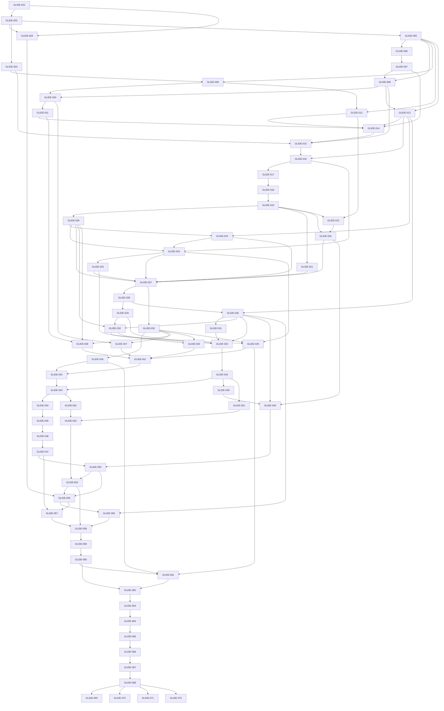

# Task dependency graph

[TODO_MASTER](TODO_MASTER.md) is status authority. Arrows mean prerequisites, not optional suggestions. Future tasks69–72 are outside V1 and require separate scope authorization. Every edge below is generated from the task definitions at planning time; update both on change.

Safe parallel examples after prerequisites: GLIDE-003/004; source access012 and receive store013 while discovery progresses; UI token work035 after MVP while background reliability proceeds; performance051/052 after their separate prerequisites. Shared coordinator, manifest, catalog and Gradle files require a single owner or sequential integration. Do not run multiple tasks against an unfrozen protocol contract.

Critical early path:001→002→005→006→007→008→010→011→014→015→016→017→018, with009/012/013 supporting prerequisites. This proves real transfer before full branding polish. All release gates converge at059 before signing/publication work. No future task is a shortcut around the Android V1 gate.

