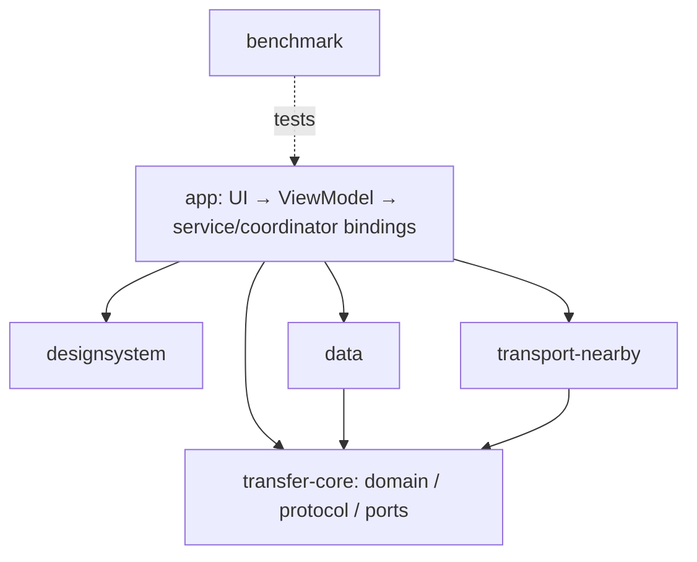

# Glide architecture
[Master](../GLIDE_MASTER_PLAN.md) · [ADRs](../adr/README.md) · [Models and state](STATE_AND_DATA_MODEL.md) · [Storage/execution](../android/STORAGE_AND_BACKGROUND.md).

## Decisions
Single-Activity Kotlin/Compose Android application; unidirectional immutable UI state, ViewModels and lifecycle-aware Flow. A process-local transfer coordinator owns deterministic protocol/session state through ports. A user-started connected-device foreground service owns active transfer lifetime. No backend, account, KMP migration, event bus, microservice or cloud dependency.

Start with five production modules, not a module per screen. Introduce the benchmark test module only at its task.
| Module | Owns | Allowed dependencies | Forbidden / future extraction |
| --- | --- | --- | --- |
| :app | Activity, navigation, feature packages, ViewModels, service, DI composition, intent ingress | All four libraries; Compose/Hilt | UI/VM importing Nearby; feature packages can be extracted if team/build evidence warrants |
| :transfer-core | Domain values, coordinator/reducer, protocol codec, ports, failure model | Kotlin, coroutines, serialization; JVM standard library | Android, GMS, Compose, Room, Context; portable specification with JVM implementation, not automatic multiplatform binary |
| :transport-nearby | Discovery, link authentication callbacks, payload mapping, GMS errors | :transfer-core, Android/GMS | UI, database, accepted-offer policy; replaceable adapter |
| :data | Room history/journal, DataStore settings, ContentResolver/private file adapters | :transfer-core, Android, persistence libraries | Compose, Nearby; implements persistence/storage ports |
| :designsystem | Theme/tokens, shared presentation controls, reviewed brand resource integration | Compose/Material only | Networking, database, service; no business state ownership |
| :benchmark (later) | Macrobenchmark/Baseline Profile test APK | Targets :app, test dependencies | No production dependency on benchmark |

## Component contracts
UI sends intents such as SelectSources, BeginDiscovery, ConfirmPeer, AcceptOffer, CancelSession; it observes a TransferUiState mapped from domain snapshots. ViewModels never call ConnectionsClient or open streams. Domain coordinator depends on TransferTransport, SourceAccess, ReceiveStore, HistoryStore, MonotonicClock and secure ID provider ports. Interfaces should expose capabilities, typed failures and cancellation, not Android exceptions or Parcelable.

Transport emits PeerAppeared/PeerLost, VerificationRequired, Connected, IncomingBulk, BulkProgress/Success/Failure and Disconnected. VerificationRequired exposes the SDK token for UI comparison, but core only accepts a ConfirmMatchingToken action originating in the current visible verification flow. Transport never auto-confirms. Data adapters translate content URI handles stored on Android side into opaque core source handles.

Do not add a use-case class for every trivial getter. Keep protocol codec and reducer separately testable inside :transfer-core. Keep sender/receiver roles and file-journal transitions explicit. Room entities map to domain snapshots; wire DTOs validate then map; UI formatting is a fourth separate model.

## Ownership and threading
The service creates/owns a SupervisorJob and limited I/O dispatcher workers; one serialized event consumer owns mutable session state. Child transfer jobs fail through typed events, never silently disappear under SupervisorJob. Activity/VM scopes own selection and screen-only work, not active streams. Process singleton coordinator is injected; no static mutable global map. Bind/rebind observes the same active session, never starts a duplicate.

Blocking ContentResolver and stream work runs on Dispatchers.IO with explicit descriptor closure on cancellation. At most one source reader and destination writer per process session; bounded buffers, no unbounded channel. UI progress sampled at <=5Hz and notifications <=1Hz. Control/security/terminal events are never dropped by sampling. Flow sharing uses explicit scope and replay=1 for current state, not replay of one-time navigation effects. Persist important outcomes; UI consumes action IDs once.

## Persistence/side effects
Reducer returns state plus effects; I/O completion feeds events back. Commit predicate in protocol is authoritative. Persist PREPARED journal before writing, VERIFIED/COMMITTING before final rename, and history after durable file visibility; reconcile crashes by journal and file hash, not UI state. Never restore a live socket from SavedStateHandle. Service/task death becomes interrupted unless a durable committed receipt already exists.

## Scope enforcement
:app feature packages home, discovery, pairing, selection, transfer, history and settings share one navigation shell. Layer boundaries can be enforced with dependency tests/import checks in GLIDE-055. No domain dependency on Nearby strategy, endpoint IDs, Android Uri or Room annotations. Future platforms reuse protocol fixtures and concepts; their native execution/storage/security adapters remain platform-specific.

