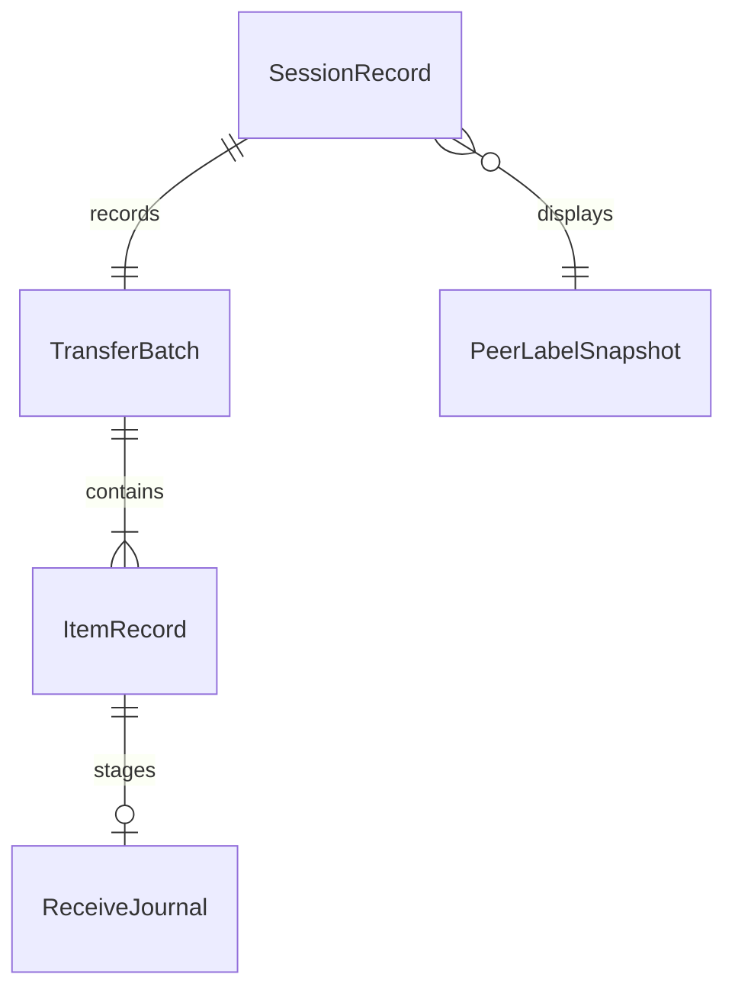
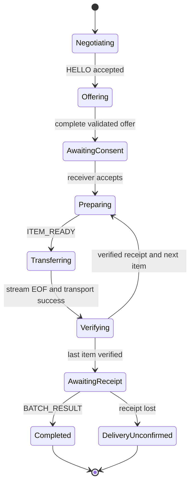

# State and data model
[Protocol](../protocol/GLIDE_PROTOCOL_V1.md) is wire authority; [storage](../android/STORAGE_AND_BACKGROUND.md) owns filesystem transaction details.

## Models
| Layer | Concepts and fields |
| --- | --- |
| Domain | PeerDevice(ephemeral peer handle, display name, availability); DeviceIdentity(session peer UUID, untrusted display name); TransferSession(id, role, link/session phase, peer); TransferBatch(id, ordered item IDs, offered bytes); TransferItem(id, display metadata, length, phase, verified digest); TransferOffer(validated immutable batch); TransferProgress(confirmed local bytes, total, phase, smoothed rate, optional ETA); TransferFailure(category, scope, retry policy); ProtocolCapabilities(version, stream/hash and limits) |
| Persistence | SessionRecord(id, role, peer label snapshot, start/end wall times, outcome); ItemRecord(id, session FK, metadata, status, digest, local opaque file key, optional exported URI); ReceiveJournal(item FK, staging key, final key, expected length, digest, phase); Settings(DataStore: name/theme/dynamic/notification privacy); no persistent TrustedPeer in V1 |
| Transport DTO | Envelope + message bodies; strings/integers only; bulkRef SDK mapping private to adapter |
| UI | Immutable screen state, formatted sizes/time, phase label, available actions, selected peer, per-item rows, validation/permission explanations; no entity or DTO exposed |

TrustedPeer is future only: verified public-key fingerprint, user alias, trust grant/revocation times and scope; device name, endpoint ID or a restored database row cannot establish trust.

## Persistence schema contract
Use Room schema exports and explicit migrations from the first schema. All IDs are TEXT UUIDs; byte counts/timestamps are INTEGER64 with nonnegative length constraints enforced in repository validation. Store stable enum codes, not Kotlin ordinal positions.

| Table | Required columns and relationships | Constraints / indexes |
| --- | --- | --- |
| sessions | session_id PK, batch_id UNIQUE, role, peer_label, started_at_ms, ended_at_ms nullable, outcome, failure_code nullable | Index started_at_ms and (role,started_at_ms); terminal outcome requires end time |
| items | item_id PK, session_id FK, ordinal, display_name, mime, offered_bytes, actual_bytes, digest nullable, outcome, failure_code nullable | UNIQUE(session_id,ordinal); index session_id; digest only after valid SHA256 check |
| received_files | file_key PK, originating_item_id UNIQUE nullable, display_name, mime, length, digest, received_at_ms, deleted_at_ms nullable | Independent file catalog survives history deletion; item link SET NULL or explicit detach transaction |
| receive_journal | item_id PK, session_id, staging_key, final_key, expected_bytes, verified_digest nullable, phase, updated_at_ms | One active entry per item; phases PREPARED/WRITING/COMMITTING; keys confined to private roots |
| exports | export_id PK, file_key FK, destination_uri, exported_at_ms | Optional remembered user-granted output only; validate access each use, never use as trusted receive proof |

Session and item rows are created transactionally before transfer effects. Receipt/history updates use a transaction; filesystem commit remains separately journaled. Clearing history detaches received_files links before deleting terminal session/item rows, never cascades file deletion. File deletion removes the private file then marks catalog deleted; reconciliation resolves interruption without reporting a missing file as available. Export URI is Android persistence only and never sent on wire. Source grants/handles are session-local or explicitly persisted Android capabilities; do not keep arbitrary source URIs indefinitely in history.

DataStore defaults: deviceName="Glide device", theme=SYSTEM, dynamicColor=false, reducedMotion=SYSTEM, notificationDetails=false, keepScreenAwake=false. Transfer limits are protocol policy, not user-editable preferences. Settings writes expose failure; no silent success on disk error. Do not add TrustedPeer or a general key-value database table in V1.

Display timestamps are wall-clock UTC instants; elapsed duration/deadlines use monotonic time. Byte counters use checked 64-bit values. Retention: history max10,000 sessions or90 days, whichever first; trim terminal rows only. Received files are not deleted by history trimming. Separate received-file catalog must retain owned file keys until explicit deletion.

## Orthogonal state machines
Discovery: Off → Starting → Active → Off (stop/120s/selection/background); Starting/Active → Unavailable on permission/radio/GMS failure. Peer list entries expire on SDK lost callback or30s stale evidence only if adapter has a defensible last-seen signal; do not fake heartbeat on Nearby endpoint callbacks. Without such a signal rely on SDK lost plus connection timeout.

Link: Disconnected → Connecting → Verifying → Connected → Disconnected. Reject/mismatch/60s timeout → Disconnected with failure. Connected only after both user confirmations AND SDK success. No Connected→Verifying reuse; reconnect creates a new session.

Session:

From every nonterminal phase, cancellation → Cancelled; protocol/storage/link error → Failed or Interrupted according to failure model. Verifying covers waiting for digest/EOF/SDK success in any callback order; events set flags without advancing prematurely. Sender Verifying includes waiting for receiver result.

Item: Queued → Preparing → Streaming → Verifying → Committing → Verified. Sender never owns a destination commit; its final transition waits ITEM_RESULT. Unfinished items may become Failed/Cancelled/Interrupted; future queued items become NotAttempted. Verified is absorbing. Batch outcome can be partial failed/cancelled/interrupted with verified files retained. Session Completed requires every item verified plus final receipt (receiver locally durable completion).

## Transition contract
| Event | Guard | Effect / invalid event |
| --- | --- | --- |
| Confirm peer | Current link Verifying, matching active attempt | Accept SDK; stale confirmation ignored |
| Offer decision | Complete validated offer, visible user action, current ID | Allocate only after accept; duplicate decision idempotent |
| Start item | Accepted batch, next ordered item, no stream active | Reserve file; out-of-order start fails protocol |
| Payload success | Known current bulk reference | Set transport flag; alone cannot complete |
| EOF | Known active stream, count exact | Set EOF flag; short/extra bytes fail |
| Digest | Current item, valid expected length/hash | Evaluate predicate; mismatch fails |
| Cancel | Any nonterminal phase | Close handles, cancel SDK, remove unverified data; post-commit file retained |
| Late progress | Terminal item/session | Ignore; never regress state |
| Disconnect | Active nonterminal state | Interrupt unfinished work; receipt wait may be unconfirmed |
| Process recreation | Journal/history exists | Reconcile durable files; never claim live connection resumed |

Actor ordering defines races, not callback arrival assumptions across threads. Test every transition and forbidden transition; terminal states are absorbing and side effects idempotent. Orientation/window changes only recreate UI; process death never reconstructs active I/O. SavedStateHandle retains safe selection/session references, not streams, authentication tokens or payload objects.
