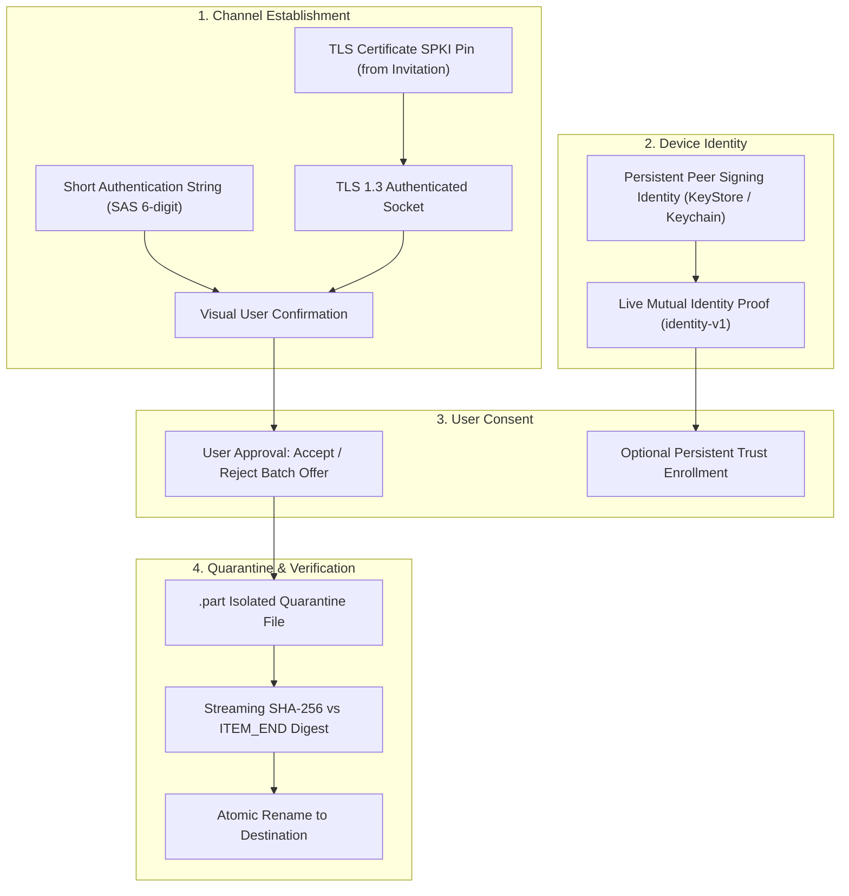

# Native Protocol, Security, and Runtime Contracts

## 1. Overview & Protocol Authority

This document defines the frozen protocol, framing, authentication, data structures, and persistence contracts that govern all native Glide implementations across **Android (Kotlin), Desktop (C# .NET 10), and Apple (Swift)**.

No protocol version change is introduced. All native platforms must strictly comply with these specifications.

---

## 2. Core Protocol Wire Framing & Envelopes

### Length-Prefixed Framing (Control and Bulk Streams)
- **Framing**: Every message on byte-stream transports is prefixed with an **unsigned 32-bit big-endian** integer indicating the payload byte length.
- **Control Envelopes**: UTF-8 JSON, strictly bounded to $\le 16,384$ encoded bytes ($16\text{ KiB}$).
- **Bulk Stream Chunks**: Raw payload chunks bounded to $\le 65,536$ bytes ($64\text{ KiB}$).
- **LAN Profile 1 Records**: 5-byte header (`[1 byte type][4 bytes big-endian length]`) followed by payload ($\le 64\text{ KiB}$).

### UUID & Field Serialization Rules
- **UUID Format**: Canonical lowercase 36-character hyphenated UUIDv4 string (e.g. `123e4567-e89b-12d3-a456-426614174000`).
- **Binary UUID Encoding**: Strict network-order (big-endian 16 bytes: 8 bytes most significant, 8 bytes least significant).
  - *Critical*: Never copy the native in-memory byte layout of Windows `Guid` (which uses little-endian fields for `Data1`, `Data2`, `Data3`) into network streams or Swift/Kotlin parsers.
- **JSON Field Types**: Byte counts and timestamps are transmitted as positive decimal strings (e.g., `"1048576"`), parsed with checked 64-bit unsigned arithmetic to guarantee exactness across all languages and platforms.
- **JSON Parsing**: Strict parser rules: no duplicate keys, invalid UTF-8 rejection, maximum nesting depth of 8, non-finite float rejection, and immediate rejection of oversized envelopes before memory allocation.

---

## 3. Fixed Protocol Ceilings & Limits

| Boundary | Ceiling | Enforcement Policy |
|---|---:|---|
| **Max items per batch** | `1,000` | Batches $>1,000$ items rejected immediately in `OFFER_BEGIN`. Batch must be non-empty ($>0$). |
| **Max file size** | `68,719,476,736` bytes (64 GiB) | Items exceeding this length fail with `PAYLOAD_SIZE_EXCEEDED`. |
| **Max batch size** | `274,877,906,944` bytes (256 GiB) | Sum of all item bytes must not overflow 64-bit int and must not exceed 256 GiB. |
| **Max control envelope** | `16,384` bytes (16 KiB) | Oversized frames dropped immediately. |
| **Max bulk chunk** | `65,536` bytes (64 KiB) | Socket reads bounded to 64 KiB buffers. |
| **Max items per offer page** | `32` items | Paginates large batches into contiguous 0-indexed `OFFER_PAGE` frames. |
| **Control rate limit** | 20 msgs/sec (burst 40) | Prevents denial of service. |

---

## 4. Native QR Invitation & Pairing Contract

The native invitation link and QR code format is standardized across all platforms:

`glide://pair/v1#<unpadded-base64url-encoded-json>`

### JSON Payload Schema
```json
{
  "invitationId": "550e8400-e29b-41d4-a716-446655440000",
  "endpoint": {
    "host": "192.168.1.100",
    "port": 42424
  },
  "transport": "lan-tls",
  "pinSha256": "4a7d1ed414474e4033ac29ccb8653d9b008d73d8269b26565e74864e7b929f04",
  "token": "7f8b9c1d2e3f4a5b6c7d8e9f0a1b2c3d",
  "expiresAt": "1727712000000",
  "role": "receiver"
}
```

### Strict Invitation Wire Requirements
1. **Prefix**: Exact scheme and path prefix `glide://pair/v1#`.
2. **Transport Value**: Must equal `"lan-tls"`.
3. **`expiresAt` Encoding**: Must be a positive decimal **string** representing epoch milliseconds (e.g. `"1727712000000"`), NOT a JSON integer.
4. **Base64url Encoding**: RFC 4648 unpadded base64url (`-`, `_`, no trailing `=`).
5. **Strict Parsing**: Reject unknown fields, duplicate keys, negative values, and non-canonical strings.
6. **Payload Hash**: When verifying invitation digests, calculate SHA-256 over the exact UTF-8 decoded JSON payload bytes.
7. **Expiry Verification**: Compare `expiresAt` with monotonic clock / system time. Reject expired invitations immediately.

---

## 5. Security Architecture & Separation of Concepts

Glide strictly differentiates five separate security concepts throughout code, contracts, and UI:



1. **TLS Certificate SPKI Pin**: Ephemeral certificate SHA-256 fingerprint from the invitation. Binds the TLS 1.3 socket and prevents MITM.
2. **Persistent Peer Signing Identity**: Hardware-backed asymmetric key (Android Keystore / Windows Protected Storage / Apple Keychain / Linux 0600 keyfile). Proves device identity across sessions.
3. **User Approval (Consent)**: Explicit human decision (`Accept` or `Reject`) to receive an offered batch. *Never auto-accepted.*
4. **Optional Persistent Trust Enrollment**: Once identity is cryptographically proven, the user may choose to remember the device. 
   - *Contract Rule*: The desktop runtime can enroll a cryptographically verified peer, with explicit approval, before file delivery finishes. UI copy must truthfully reflect this rather than claiming enrollment only occurs after transfer completion.
5. **File Length and Digest Verification**: Independent integrity check. Raw bytes stream into quarantined `.part` staging; atomic rename occurs strictly after matching exact byte count and SHA-256 digest.

---

## 6. Implementation Mapping Matrix

| Contract Element | Android Kotlin (`android/core`) | Desktop C# (`desktop/src/Glide.Core`) | Apple Swift (`apple/GlideCoreKit`) |
|---|---|---|---|
| **Invitation Model** | `dev.glide.core.pairing.LanInvitation` | `Glide.Core.Pairing.LanInvitation` | `GlideCoreKit.LanInvitation` |
| **Invitation Codec** | `dev.glide.core.pairing.InvitationCodec` | `Glide.Core.Pairing.InvitationCodec` | `GlideCoreKit.InvitationCodec` |
| **Protocol Codec** | `dev.glide.core.protocol.ProtocolCodec` | `Glide.Core.Wire.ProtocolCodec` | `GlideCoreKit.ProtocolCodec` |
| **Framing Channel** | `dev.glide.core.transport.lan.LanRecordChannel` | `Glide.Transport.Framing.LengthPrefixedFrameChannel` | `GlideCoreKit.FramedChannel` |
| **SAS Calculator** | `dev.glide.core.pairing.SasCalculator` | `Glide.Core.Security.SasCalculator` | `GlideCoreKit.SasCalculator` |
| **Path Sanitizer** | `dev.glide.data.source.FilenameSanitizer` | `Glide.Core.Storage.WindowsPathSanitizer` | `GlideCoreKit.PathSanitizer` |
| **Quarantine Store** | `dev.glide.data.store.ResumableStagingStore` | `Glide.Core.Storage.QuarantineStagingStore` | `GlideCoreKit.QuarantineStagingStore` |
| **Persistent Trust** | `dev.glide.core.identity.PersistentTrustManager` | `Glide.Core.Security.DesktopTrustStore` | `GlideCoreKit.TrustStore` |

---

## 7. Dual Connection Roles (Sender-Hosted & Receiver-Hosted)

Glide supports two symmetrical LAN connection patterns:
1. **Receiver-Hosted (Traditional)**: Receiver advertises mDNS or shows QR code with its local IP/port. Sender connects as TLS client.
2. **Sender-Hosted (Quick QR)**: Sender creates a local TLS listener and presents a QR code containing its IP/port. Receiver scans QR code, connects as TLS client, and issues receiving commands (`ReceiveFromInvitationAsync`).

**Channel Binding Rule**:
- When the receiver hosts TLS, channel binding derives from the **local receiver certificate**.
- When the sender hosts TLS, channel binding derives from the **remote sender certificate**.
