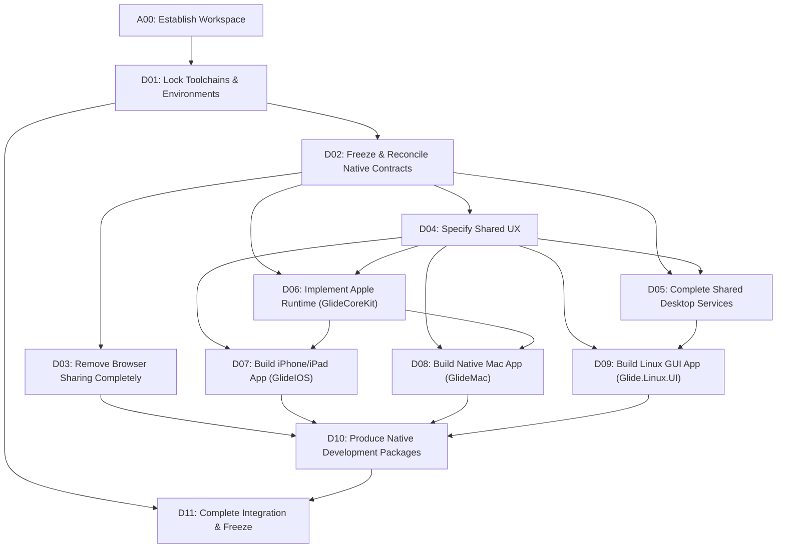

# Glide Native-Platform Completion Master Plan

## 1. Executive Summary & Objective

The primary objective of this program is to deliver complete native applications for **iPhone, iPad, macOS, and Linux**, remove browser-based file transfer completely across all platforms, and preserve 100% interoperability with the existing Windows and Android applications.

This plan establishes the authoritative task list, explicit dependency graph, architecture contracts, and completion definitions.

---

## 2. Product Decisions & Scope Baseline

| Area | Decision & Requirement |
|---|---|
| **Product Name & Brand** | Preserve **Glide** and all existing brand assets (colors, typography, identity). Renaming is strictly outside this work. |
| **Windows Platform** | Preserve WPF on .NET 10 (`net10.0-windows`) and the existing desktop visual design. Refactor shared runtime integration to use extracted shared services. |
| **Android Platform** | Preserve Kotlin 2.4.20 / Jetpack Compose, existing Nearby and LAN sharing, and visual direction. Completely remove browser sharing UI, ViewModels, and assets. |
| **iPhone & iPad Platform** | Build a native SwiftUI application using UIKit adapters where necessary. Target iOS/iPadOS 16+ deployment floor. Include an iOS Share Extension with App Group staging. Adaptive multi-column layout on iPad. |
| **macOS Platform** | Build a native SwiftUI application with AppKit integration. Target macOS 13+ deployment floor. Feature a standard main window, Dock identity, native menu bar integration, drag-and-drop, Finder reveal, and optional menu-bar status item. |
| **Linux Desktop** | Build a native desktop GUI using **Avalonia 12.1.3** on .NET 10 (`net10.0`). Integrate with the shared cross-platform desktop engine (`desktop/src/Glide.Desktop`). Rendering baseline: **X11 and XWayland** (native Wayland is experimental and deferred). Target Ubuntu 24.04 LTS and Fedora 41. Build packages for x64 and ARM64. |
| **Apple Coverage** | iPhone, iPad, and Mac. (watchOS, tvOS, and visionOS are explicitly outside this delivery). |
| **Transport & Sharing** | Local native peer-to-peer sharing over LAN (TLS 1.3 over TCP, mDNS `_glide._tcp`) and Android Nearby Connections. Native QR and link scheme: `glide://pair/v1#`. |
| **Browser Sharing Removal**| Completely eliminate browser sharing gateways (`GlideWebGateway`, `SecureBrowserGateway`), browser-only WebRTC assets, HTTP listeners, SPA static files, and `glide web` CLI/UI entry points. |
| **Distribution Scope** | Produce development-installable artifacts and clear installation/uninstallation/retention instructions. Public app store submissions and public release hosting remain deferred. |
| **Work Sequencing** | **Phase 1: Product implementation and build/package preparation.**  **Phase 2: Formal testing, validation, and corrections.** |

---

## 3. Two-Tier Completion Standard ("100% Complete")

To maintain complete engineering truthfulness, two distinct completion states are enforced:

1. **Implementation Complete (Phase 1 Exit Gate):**
   - Every required feature has real production code.
   - Every UI control and action is connected to real backend/service coordinators (zero mock services, zero timer-based progress, zero placeholder success screens).
   - All applications and packages compile, link, and package cleanly on their supported build hosts.
   - Missing required platform tools (e.g., Xcode on non-Mac hosts) are recorded as explicit blockers rather than bypassed.

2. **Validated Complete (Phase 2 Exit Gate):**
   - Phase 2 validation matrix passes completely.
   - Physical cross-platform transfers pass across the 15 platform pairs (30 transfer directions).
   - Real installation, upgrade, and uninstallation verification passes on physical hosts.

---

## 4. Phase 1 — Implementation Tasks (D01 – D11)

- **A00 — Establish the handoff workspace**: Create planning documents (`MASTER_PLAN.md`, `TASKS.md`, `CONTRACTS.md`, `UX_SPEC.md`, `VALIDATION_MATRIX.md`, `HANDOFF.md`).
- **D01 — Lock toolchains and supported environments**: Pin SDKs, dependencies, Avalonia 12.1.3, deployment floors (iOS 16, macOS 13, Ubuntu 24.04, Fedora 41), document toolchain requirements.
- **D02 — Freeze and reconcile native protocol contracts**: Reconcile Kotlin, C#, and Swift protocol codecs (`glide://pair/v1#`, `lan-tls`, `expiresAt` decimal string, strict validation, checked math, 5-byte record framing, network-order UUIDs).
- **D03 — Remove browser-based sharing completely**: Removal inventory; eliminate `GlideWebGateway`, `SecureBrowserGateway`, SPA assets, `glide web` CLI/UI entry points across Android and Desktop.
- **D04 — Specify the shared user experience**: Define common screen contract (Send, Quick QR, Nearby, Saved, Pair, Receive, Activity, Settings), state machine, accessibility, layout adaptations.
- **D05 — Complete the shared desktop application services**: Extract core orchestration from Windows WPF into `Glide.Desktop`, implement missing receiver-as-client operation `ReceiveFromInvitationAsync`, typed events, correct certificate pinning.
- **D06 — Implement the Apple runtime**: Modernize `apple/GlideCoreKit` with Network.framework TLS/TCP listeners/clients, Bonjour `_glide._tcp`, Keychain identity, streaming file send/receive, quarantine staging.
- **D07 — Build the complete iPhone/iPad application**: Create `GlideApple.xcodeproj` with `GlideIOS` scheme; SwiftUI views, Files/Photos pickers, QR camera scanner, Share Extension with App Group staging.
- **D08 — Build the complete native Mac application**: `GlideMac` scheme in `GlideApple.xcodeproj`; native SwiftUI/AppKit desktop app, Dock identity, menu bar, drag-and-drop, Finder reveal, bookmark security.
- **D09 — Build the complete Linux desktop application**: Create `desktop/linux/Glide.Linux.UI` using Avalonia 12.1.3 on .NET 10; X11/XWayland, native storage provider dialogs, XDG paths, single-instance coordination.
- **D10 — Produce native development packages**: Build Windows installer EXE, Android APK/AAB, iOS simulator/archive, macOS .app ZIP/DMG, Linux .deb/.rpm for x64/ARM64.
- **D11 — Complete implementation integration and freeze**: Reconcile all actions, update architecture documentation, refresh Graphify knowledge graph, Phase 1 exit gate audit.

---

## 5. Phase 2 — Testing & Validation Gates (V01 – V07)

1. **V01 — Contract and security validation**: Positive/negative fixtures across Kotlin, C#, and Swift.
2. **V02 — Runtime and persistence validation**: Lifecycle, cancellation, quarantine, crash recovery, and storage validation.
3. **V03 — UI and accessibility validation**: Light/Dark, 100%-200% scaling, TalkBack, VoiceOver, Narrator, Orca, keyboard navigation.
4. **V04 — Physical interoperability**: 15 platform pairs across 6 client classes (Windows, Android, iPhone, iPad, macOS, Linux) in both directions (30 directed flows).
5. **V05 — Package installation and removal**: Fresh install, launch, upgrade, uninstall, data retention verification.
6. **V06 — Browser-removal regression**: Zero web sharing remnants, listeners, or CLI routes.
7. **V07 — Usability and correction loop**: 5 representative user walkthroughs, feedback incorporation.

---

## 6. Development Rules for Antigravity

1. **Bounded Tasks**: Work on one task at a time in strict dependency order.
2. **Read Before Edit**: Understand existing source files and callers before editing.
3. **Preserve Compatibility**: Keep Windows and Android native behavior fully compatible.
4. **No Placeholders**: Never substitute missing functionality with fake timers, mocks, or simulated progress.
5. **Phase Separation**: In Phase 1, focus on implementation, compilation, and packaging. Do not run Phase 2 tests or claim validation before Phase 2.
6. **Toolchain Honesty**: Record blockers when an external host (e.g. Mac build host) is not present. Never claim an unbuilt package succeeded.
7. **Maintain Ledgers**: Update `TASKS.md` and `HANDOFF.md` at each task transition.
