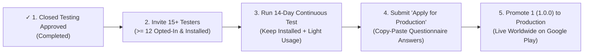

# Closed Testing (12 Testers / 14 Days) & Production Access Guide — Glide v1.0.0

**Application:** Glide — Fast Local Share (`dev.glide.app`)  
**Current Play Console Status:**  
- **Internal testing:** `Active`  
- **Closed testing (`Alpha`):** `Active • 1 track` (`✓ Publish a closed testing release` completed)  
- **Current Gate:** `Apply for access to production` (`12 testers` $\times$ `14 consecutive days`)

---

## Overview of This Stage

Now that Google Play has reviewed and approved your Closed Testing release (`✓ Publish a closed testing release`), you are on the final step before unlocking worldwide **Production** publishing:



---

## Stage 1: Set Up Your Closed Testing Testers & Get the Opt-In Link

Right now your Dashboard shows **`0 testers currently opted in`**. Adding email addresses to a list is only half of the setup—testers only count as **"opted-in"** after you assign the list to your **Closed testing - Alpha** track **and** each tester opens your opt-in URL and clicks **"Become a tester"** + installs the app.

### Step-by-Step in Google Play Console:
1. In the left sidebar of Google Play Console, click **Test and release** (the rocket icon) $\rightarrow$ **Testing** $\rightarrow$ **Closed testing**.
2. Next to your **Closed testing - Alpha** track (`Active`), click **Manage track**.
3. Click the **Testers** tab (next to `Releases` and `Countries/regions`).
4. Under **Testers**:
   - You can check your existing email list **or** click **Create email list** to create a dedicated list (e.g., `Closed Alpha Cohort`).
   - **Important Buffer Rule:** Add **15 to 20 Gmail / Google Account email addresses** (friends, family, classmates, colleagues, or extra Google accounts on secondary devices).
   - *Why 15–20 instead of 12?* Google requires **at least 12 continuously opted-in testers for 14 straight days**. Having 15–20 people gives you a safe 3–8 person buffer in case someone changes their phone or accidentally uninstalls the app.
   - Remember to press **`Enter`** after typing/pasting email addresses so they appear in the **"Email addresses added"** box below, then click **Save changes**.
5. Make sure the **checkbox** next to your email list is **checked**.
6. Scroll down to **Feedback URL or email address**:
   - Enter your contact email address so testers have a feedback channel (Google Play checks that a feedback mechanism is configured).
7. Click the blue **Save** button in the bottom-right corner.
8. Scroll back to the section titled **"How testers join your test"** (now unlocked at the bottom of the **Testers** tab) and copy both links:
   - **Join on the web (Recommended):**
     ```text
     https://play.google.com/apps/testing/dev.glide.app
     ```
   - **Join on Android:**
     ```text
     https://play.google.com/store/apps/details?id=dev.glide.app
     ```

---

## Stage 2: Onboard Your 12+ Testers (Ready-to-Send Invite Script)

Send the message below via WhatsApp, Telegram, Discord, or Email to the **15–20 people** whose Gmail addresses you added to your Closed Testing list.

### Copy-Paste Message to Send to Your Testers:
```text
Hey! Could you help me pass Google Play's 14-day tester requirement for my new Android app, Glide (offline peer-to-peer file sharing)? It only takes 60 seconds:

1. Make sure you are signed into the Google Play Store with the Gmail address you gave me.
2. Open this opt-in link:
https://play.google.com/apps/testing/dev.glide.app
3. Tap the blue "Become a tester" button, then tap "Download it on Google Play" and install Glide (it's only 4 MB!).
4. Open the app once and tap around for 30 seconds.
5. IMPORTANT: Please keep Glide installed on your phone for the next 14 days (do not uninstall it until I let you know the 14-day timer is done!).

Thank you so much!
```

### How to Confirm a Tester Is Counted:
- Once a tester taps **"Become a tester"** and installs Glide on their Android phone, Google Play Console updates the counter on your **Dashboard** (`X testers currently opted in`).
- *Note:* The Dashboard counter updates every few hours (sometimes up to 12–24 hours after opt-in). Once it reaches **`12 testers currently opted in`** (or higher), the second milestone gets a green checkmark (`✓`) and the **14-day countdown automatically begins**!

---

## Stage 3: The 14-Day Continuous Flight Rules (Avoid Delays or Resets)

Google Play's review system checks both **opt-in continuity** and **real tester activity** before granting production access. Follow these 4 rules during the 14 days:

| Rule | What to Do | Why It Matters |
| :--- | :--- | :--- |
| **1. Do Not Uninstall for 16 Days** | Ask testers to keep Glide installed during the 14-day countdown **plus 2 extra days** while Google reviews your Production application. | If active installations drop below 12 before approval, the milestone pauses. |
| **2. Open the App a Few Times** | Have yourself and at least a few testers open Glide on **Day 1**, **Day 5**, and **Day 11** to browse tabs (`Send`, `Receive`, `Activity`, `Settings`) or send a test file. | Prevents Google from rejecting the application for *"insufficient tester engagement"*. |
| **3. Optional Mid-Test Update (Day 7–10)** | Around Day 7–10, you can optionally upload a tiny update (`versionCode = 2`, `1.0.1`) to the **Closed testing - Alpha** track using `pwsh -File tools/build-play-release.ps1 -VersionName "1.0.1" -VersionCode 2`. | Shows Google Play reviewers that you actively iterated on tester feedback during the closed test. |
| **4. Check Android Vitals Once a Week** | In Play Console, click **Monitor and improve** $\rightarrow$ **Android vitals** $\rightarrow$ **Overview** to confirm 0 crashes and 0 ANRs. | You will reference your clean crash/ANR vitals in the Day 14 questionnaire. |

---

## Stage 4: Exact Copy-Paste Answers for "Apply for Production" (Day 14)

As soon as the 14-day counter completes on your Dashboard, the grey **`Apply for production`** button turns blue!

When you click **`Apply for production`** (you can preview these right now by clicking **`Preview questions`** on your Dashboard), Google Play asks 3 sets of questions. Each text box enforces a strict **300-character maximum**. Every answer below is carefully written to stay **under 285 characters** so you can copy and paste them directly without truncation.

---

### Part 1: About Your Closed Test

#### Q1.1: *How did you recruit testers for your closed test? For example, did you ask friends and family, or use a paid testing provider?*
- **Checkboxes (if shown):** Select **Friends and family** and/or **Colleagues / Professional network** *(never select paid testing providers unless actually used)*.
- **Text Box Answer (264 / 300 characters):**
```text
I recruited 15+ testers from friends, family, university peers, and developer colleagues owning diverse Android phones and tablets (Android 8 to 17). Each tester was added to the Closed Testing email list, opted in via the web link, and tested transfers on Wi-Fi.
```

#### Q1.2: *How easy was it to recruit testers for your app?*
- **Selection:** Select **Easy** or **Neither easy nor difficult** (2 or 3 on the scale).

#### Q1.3: *Describe the engagement you received from testers during your closed test:*
- **Sub-question A:** *Did testers use all of the features in your app?* $\rightarrow$ Select **Yes**.
- **Sub-question B:** *Did testers use your app in the way you would expect real users to use it in production?* $\rightarrow$ Select **Yes**.
- **Text Box Answer (278 / 300 characters):**
```text
Testers installed Glide from Google Play and exercised all core features across the 14-day period: nearby peer discovery, 6-digit SAS pairing, QR code scanning, single and multi-file transfers, background transfers via the foreground notification, and transfer history.
```

#### Q1.4: *Provide a summary of the feedback you received from testers. Include how you collected the feedback.*
- **Text Box Answer (275 / 300 characters):**
```text
Feedback was collected via direct email, messaging group check-ins, and Play Console feedback channels. Testers praised transfer speed and the 6-digit SAS verification prompt, and provided helpful feedback on tablet landscape layouts and clear permission explanations.
```

---

### Part 2: About Your App

#### Q2.1: *Who is the target audience of your app?*
- **Text Box Answer (248 / 300 characters):**
```text
General Android smartphone and tablet users, students, photographers, and professionals who need to share photos, videos, and large documents directly between nearby devices offline with zero mobile data usage and zero cloud storage uploads.
```

#### Q2.2: *Describe how your app provides value to users:*
- **Text Box Answer (273 / 300 characters):**
```text
Glide lets users transfer large files and batches directly between nearby devices over Wi-Fi Direct and local Wi-Fi completely offline. It protects privacy with TLS encryption, mutual 6-digit SAS verification, SHA-256 integrity checks, zero ads, and zero cloud tracking.
```

#### Q2.3: *How many installs do you expect your app to have in the first year?*
- **Selection:** Select **`1,000 - 10,000`** (or **`100 - 1,000`** — a realistic organic projection for a utility launch).

---

### Part 3: Production Readiness

#### Q3.1: *What changes did you make to your app based on what you learned during your closed test?*
- **Text Box Answer (276 / 300 characters):**
```text
Based on closed testing across phone and tablet screens, we refined the adaptive two-pane tablet layouts, improved in-app privacy and permission disclosures, verified foreground service notification cancellation behavior, and confirmed zero R8 serialization issues.
```

#### Q3.2: *How did you decide that your app is ready for production? Include any metrics or criteria you used.*
- **Text Box Answer (279 / 300 characters):**
```text
We verified 0% crash rate and 0% ANR rate in Play Console Android Vitals across 14 continuous days of closed testing, 100% SHA-256 payload integrity on all test transfers, clean background foreground service termination, and passing automated unit and security test gates.
```

---

## Stage 5: Final Rollout to Production (After Approval)

Once you submit the **Apply for production** form on Day 14, Google Play reviews your application (usually approved within **1 to 3 business days**, often under 24 hours). You will receive an email stating **"Your app has been granted production access"**.

### Final 4 Clicks to Publish Worldwide:
1. Open Google Play Console $\rightarrow$ in the left sidebar click **Test and release** $\rightarrow$ **Testing** $\rightarrow$ **Closed testing** $\rightarrow$ **Manage track (Alpha)**.
2. Next to your active release, click **`Promote release ▾`** $\rightarrow$ select **`Production`**.
   *(Alternatively, go to **Test and release** $\rightarrow$ **Production** $\rightarrow$ **Create new release** $\rightarrow$ **Add from library** and select your bundle).*
3. In **Countries / regions** on the **Production** page, click **Add countries / regions**, select **All countries / regions** (178 countries), and click **Save**.
4. Review the release, verify **Rollout percentage** is **`100%`**, and click **Save and publish** $\rightarrow$ **Send changes for review**.

Within 1–3 days of submitting the Production release, **Glide — Fast Local Share** will be publicly live and searchable worldwide on the Google Play Store!
