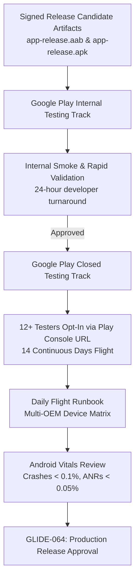

# Closed Testing Protocol & Operations Runbook

**Document Version:** 1.0.0  
**Effective Date:** 2026-09-14  
**App Name:** Glide (`dev.glide.app`)  
**Target Tracks:** Google Play Internal Track & Closed Testing Track (Alpha)  
**Governance Authority:** [GLIDE_RELEASE_PLAN.md](GLIDE_RELEASE_PLAN.md) · [CI/CD_PLAN.md](../development/CI_CD_PLAN.md) · [TODO_MASTER.md](../TODO_MASTER.md)

---

## 1. Regulatory Context & Policy Objectives

Google Play developer policy (enforced since November 13, 2023 for newly registered personal accounts) requires apps to complete a closed testing phase before applying for production access:
1. **Mandatory Participation:** At least **12 distinct Google accounts** must be continuously opted into the closed test track.
2. **Mandatory Duration:** The test must remain active for at least **14 consecutive days**.
3. **Engagement Verification:** Testers must actively download, install, and exercise the application during the 14-day window; Play Console evaluates opt-in continuity and engagement metrics.
4. **Internal Track Prerequisite:** Initial builds are deployed to the **Internal Testing Track** (up to 100 internal team testers, instant distribution without Play review) to verify basic bundle integrity, before publishing to the **Closed Testing Track** (requires standard automated/human Google Play review).

---

## 2. Testing Track Architecture

### Track Definitions
- **Internal Testing Track:**
  - Audience: Core engineering, QA custodians, and internal device owners.
  - Review: Instant upload; no approval delay.
  - Artifact: Signed `.aab` (`app-release.aab`).
  - Goal: Immediate verification that Play App Signing resigns the AAB correctly and devices receive valid APK splits.
- **Closed Testing Track (Alpha):**
  - Audience: Curated Google Group of 15+ external testers (ensuring $\ge 12$ active buffer).
  - Review: Subject to standard Google Play prelaunch checks and policy review.
  - Distribution: Opt-in URL (`https://play.google.com/apps/testing/dev.glide.app`).
  - Goal: 14 consecutive days of active peer-to-peer sharing and vitals collection.

---

## 3. Tester Cohort & Multi-OEM Hardware Matrix

To ensure compatibility across the fragmented Android ecosystem, the tester cohort must satisfy the following distribution across OS versions and device manufacturers:

| Cohort Group | Minimum Testers | Device Profiles & Targets | Android Versions | Focus Areas |
|---|:---:|---|---|---|
| **Tier 1: Modern Flagship** | 4 | Google Pixel 9 / 10, Samsung Galaxy S24 / S25, OnePlus 12 / 13 | Android 14, 15, 17 (API 34–37) | 16 KB page size, Nearby Wi-Fi Devices, Android 17 Local Network permissions |
| **Tier 2: Mid-Range Workhorse** | 4 | Google Pixel 7a / 8a, Samsung Galaxy A54 / A55, Motorola Edge | Android 13, 14 (API 33–34) | Foreground service multitasking, Doze transitions, notification actions |
| **Tier 3: Legacy & Budget** | 4 | Nokia G-series, Xiaomi Redmi Note, Samsung Galaxy A14 | Android 8.0 – 12 (API 26–31) | Fine/Coarse Location permission fallback, legacy storage, low RAM (2–4 GB) |
| **Tier 4: Tablets & Foldables** | 2 | Google Pixel Tablet, Samsung Galaxy Tab S9, Pixel Fold | Android 14, 15 (API 34–35) | Adaptive layout, landscape orientation, two-pane navigation scaffold |

**Total Confirmed Testers:** 14 (provides a 2-tester margin above the 12-tester hard requirement).

---

## 4. 14-Day Daily Flight Test Schedule

Every tester executes a daily test run following this standardized test protocol:

| Flight Day | Test Scenario | Operational Steps | Expected Outcome |
|---|---|---|---|
| **Day 1–2** | **Initial Setup & First Discovery** | 1. Opt in via Play URL. 2. Install from Play Store. 3. Grant runtime permissions. 4. Perform mutual discovery. | Discovery radar shows nearby peer within 15s; 6-digit SAS code displays identically on both devices. |
| **Day 3–4** | **Small & Medium File Transfers** | Transfer 1 to 5 photos, PDFs, and text files ($1\text{ MB} - 50\text{ MB}$). | Progress bar updates smoothly; SHA-256 verified; file commits to Downloads without corruption. |
| **Day 5–6** | **High-Throughput Bulk Batches** | Transfer large video file ($1\text{ GB} - 5\text{ GB}$) or batch of 50+ images. | Transfer throughput exceeds $30\text{ MB/s}$ on Wi-Fi Direct; RAM remains bounded under 128 MB. |
| **Day 7–8** | **Background Multitasking & Doze** | Start transfer, lock screen, switch to other apps, let device enter Doze. | `TransferService` keeps connectedDevice foreground notification alive; transfer finishes in background. |
| **Day 9–10** | **Clean Cancellation & Fault Injection** | 1. User cancels midway. 2. Receiver toggles Wi-Fi off. 3. Walk devices out of range. | Active transfer halts cleanly within 2s; partial staging files wiped immediately (zero orphan leak). |
| **Day 11–12** | **History Management & Database** | Inspect Transfer History tab; filter by Sent/Received; perform "Clear history". | Database queries return instantaneously; UI renders history cleanly; Room stores records reliably. |
| **Day 13–14** | **Vitals Audit & End-of-Flight Review** | Review Play Console Android Vitals; verify opt-in continuity; collect feedback. | 14 continuous days completed; zero fatal crashes; ready for production application. |

---

## 5. Android Vitals Monitoring & Quality Thresholds

During closed testing, the publisher reviews Google Play Console **Android Vitals** daily. The release candidate must strictly meet or exceed these thresholds:

| Quality Metric | Google Play "Bad Behavior" Threshold | Glide Production Target | Monitored Action |
|---|:---:|:---:|---|
| **User-Perceived Crash Rate** | $\ge 1.09\%$ | $\mathbf{< 0.10\%}$ | Any crash halts rollout; immediate forward-fix required. |
| **User-Perceived ANR Rate** | $\ge 0.47\%$ | $\mathbf{< 0.05\%}$ | ANRs during discovery or transfer must be diagnosed via trace. |
| **Excessive Wake Locks** | $> 0.10\%$ of sessions | $\mathbf{0.00\%}$ | Glide uses Foreground Service instead of raw partial wake locks. |
| **Excessive Background Wi-Fi Scans** | $> 0.10\%$ of sessions | $\mathbf{0.00\%}$ | Scans only execute while discovery UI or transfer is actively running. |
| **Slow Startup (Cold Launch)** | $> 5.00\text{ s}$ | $\mathbf{< 1.20\text{ s}}$ | ProfileInstaller baseline profile optimizes cold start paths. |

---

## 6. Feedback Collection & Bug Triage Runbook

### Privacy-Preserving Diagnostics
Glide is built on strict privacy invariants. When reporting bugs or unexpected behavior:
1. **Zero Content Access:** Testers must **never** share private transferred files or screenshots containing personal filenames or photos.
2. **Sanitized Diagnostics:** Error reports collected via Play Console or testing forms contain only:
   - Device model, manufacturer, and Android version.
   - Exception class name and deobfuscated stack trace line numbers (using `mapping.txt`).
   - Transfer protocol state machine phase (e.g., `Negotiating`, `Streaming`, `Verifying`).
   - Radio topology code (e.g., `WIFI_DIRECT`, `BLE`).

### Triage Severity & Resolution SLAs
- **P0 (Blocker):** Data corruption, unverified file exposure, peer impersonation, or crash during core transfer.
  - *SLA:* Triage within 4 hours; patch released to internal track within 24 hours.
- **P1 (Critical):** Connection establishment failure on a specific OEM, foreground service termination by OS, ANR during file staging.
  - *SLA:* Triage within 12 hours; patch released within 48 hours.
- **P2 (Major):** UI layout clipping on specific screen sizes, progress percentage rounding inaccuracy, history sorting glitch.
  - *SLA:* Addressed in next scheduled release candidate build.

---

## 7. Play Console Reviewer Demonstration Guidance

To facilitate Google Play App Review without requiring accounts or test credentials:
1. **No Account Required:** Reviewers do not need username, password, or cloud login.
2. **Two-Device Requirement:** Local P2P transfer testing requires two physical Android devices (or two emulators on the same subnet).
3. **Reviewer Step-by-Step Instructions:**
   - Install Glide on Device A and Device B.
   - On Device A: Tap **Send files** $\rightarrow$ select any sample photo/document $\rightarrow$ device enters discovery mode.
   - On Device B: Tap **Receive files** $\rightarrow$ device advertises availability.
   - On Device A: Tap Device B's name in the radar view.
   - Both devices: Verify the 6-digit Short Authentication String (SAS) match $\rightarrow$ tap **Accept** on Device B.
   - Transfer completes directly over Wi-Fi Direct with real-time throughput metrics.
4. **Foreground Service Video:** Provided demo link demonstrating background file transfer and ongoing notification with cancel action per [`FOREGROUND_SERVICE_DECLARATION.md`](FOREGROUND_SERVICE_DECLARATION.md).
