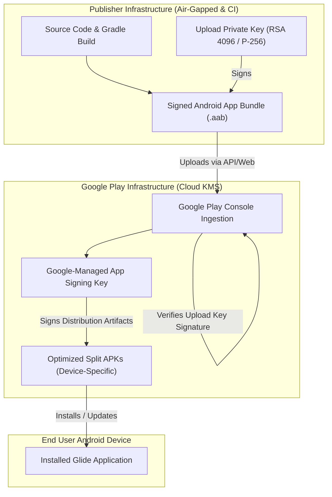

# Key Custody and Publisher Identity Policy — Glide

**Document Version:** 1.0.0  
**Effective Date:** 2026-09-14  
**Milestone:** M11 — Release preparation (GLIDE-060)  
**Governing Documents:** [`GLIDE_RELEASE_PLAN.md`](GLIDE_RELEASE_PLAN.md) · [`CI_CD_PLAN.md`](../development/CI_CD_PLAN.md) · [`DEFINITION_OF_DONE.md`](../DEFINITION_OF_DONE.md) · [`GEMINI_ENGINEERING_RULES.md`](../development/GEMINI_ENGINEERING_RULES.md)  

---

## 1. Executive Overview

This policy establishes the cryptographic custody, key separation architecture, publisher identity governance, and monotonic versioning controls required for all production, beta, and internal release candidate artifacts of the Glide application.

Under [`docs/development/GEMINI_ENGINEERING_RULES.md`](../development/GEMINI_ENGINEERING_RULES.md), signing secrets and private keys must never be committed to source control. Google Play App Signing must be utilized to physically decouple the **App Signing Key** from the publisher-controlled **Upload Key**, mitigating the risk of irreversible key compromise.

---

## 2. Publisher Identity & Namespace Governance

### 2.1 Package Identifier Strategy
- **Provisional Application ID:** `dev.glide.app` (used during development and internal testing).
- **Final Publisher Application ID:** The application ID in `app/build.gradle.kts` is dynamically configurable via the `GLIDE_APPLICATION_ID` environment variable or `glide.applicationId` Gradle property.
- **Irreversibility Warning:** Once an Android package is published to Google Play Console, its `applicationId` is immutable for the lifetime of the application. The publisher identity must be legally registered and domain-verified prior to the first public store listing.

### 2.2 Namespace Naming Standards (RFC / Android SDK Compliance)
All valid application identifiers for Glide must satisfy:
1. Must contain at least two segments (e.g. `dev.glide.app` or `com.publisher.glide`).
2. Each segment must start with a letter (`[a-zA-Z]`).
3. Subsequent characters in each segment must be alphanumeric or underscores (`[a-zA-Z0-9_]`).
4. Segments must not collide with Java or Kotlin reserved keywords (`class`, `switch`, `assert`, `import`, etc.).
5. Total package name length must not exceed 255 characters.

### 2.3 Trademark and Naming Collision Clearance
- **Glide Image Loader Coexistence:** The Android open-source ecosystem includes a widely used image-loading library (`com.github.bumptech.glide`). 
- **Collision Resolution:** Glide file sharing is identified by its distinct package namespace (`dev.glide.app`) and full product title: **"Glide — Seamless Local File Sharing"**. Dependency conflicts are completely avoided as the Glide file-sharing client does not bundle or expose the `com.github.bumptech.glide` group ID, preferring Coil for optional internal image rendering where required.

### 2.4 Google Play Console Account Setup
- **Organization Accounts:** Requires a valid D-U-N-S (Data Universal Numbering System) number matching official company registration documents.
- **Personal Accounts:** Personal accounts created after November 13, 2023, must fulfill Google Play's mandatory closed testing requirement: at least **12 continuously opted-in testers for 14 days** prior to applying for production track access (governed in GLIDE-063).

---

## 3. Google Play App Signing Separation Model

Glide enforces the industry-standard two-tier key separation model:



### 3.1 Upload Key Specifications
The upload key signs release AABs prior to ingestion by Google Play.
- **Algorithm:** RSA with minimum 4096-bit key size (or Elliptic Curve ECDSA P-256).
- **Signature Algorithm:** `SHA256withRSA` (or `SHA256withECDSA`).
- **Validity Period:** Minimum 25 years (10,000 days) to prevent mid-lifecycle expiration.
- **Signature Schemes Enforced:** APK Signature Scheme v1 (JAR signing), v2 (Full APK), v3 (Key rotation support), and v4 (fs-verity streaming).

### 3.2 Key Separation Invariants
1. **Zero Secret Storage in Git:** Neither `.jks`, `.keystore`, `.p12`, nor plain text passphrases may ever enter the Git repository. Verified by `.gitignore` and automated pre-commit scanners.
2. **Independent Upload Rotation:** If the upload key is compromised or lost, the production user base is NOT impacted. An upload key reset is performed via Play Console without disrupting installed app update paths.

---

## 4. Key Custody & Multi-Custodian Procedures

### 4.1 Cold Storage and Key Protection
- **Primary Keystore Vault:** The release upload keystore is stored on an encrypted, air-gapped hardware security key (e.g., FIPS 140-2 Level 3 validated USB drive such as Kingston IronKey or YubiKey HSM).
- **Split-Knowledge Protocol:** 
  - Custodian A holds the physical hardware security token.
  - Custodian B holds the encrypted keystore passphrase in an audited enterprise password manager.
  - Neither custodian alone possesses both the physical key file and the unlocking passphrase.
- **Secondary Backup:** An encrypted offline copy is maintained in an off-site physical safe.

### 4.2 CI/CD Release Signing Automation
For automated release builds in CI:
- **Ephemeral Injection:** Keystore bytes are injected as base64-encoded GitHub Actions secret (`GLIDE_RELEASE_KEYSTORE_BASE64`) into a temporary file on an ephemeral runner.
- **Memory-Only / Single-Job Lifetime:** The temporary keystore file is unlinked immediately upon build completion.
- **Zero Artifact Leaks:** Build logs are filtered to mask all passphrase environment variables (`GLIDE_RELEASE_KEYSTORE_PASSWORD`, `GLIDE_RELEASE_KEY_PASSWORD`).

---

## 5. Monotonic Versioning Governance

Google Play Console strictly enforces monotonic integer version codes. Version downgrades or duplicate codes are rejected at upload time.

### 5.1 Version Code Schema
The integer `versionCode` is computed using a deterministic semantic formula:
$$\text{versionCode} = (\text{Major} \times 10{,}000) + (\text{Minor} \times 100) + \text{Patch}$$

| Release Stage | `versionName` | `versionCode` | Description |
|---|:---:|:---:|---|
| **Initial RC** | `1.0.0-rc01` | `10000` | First release candidate submission |
| **Patch / RC Fix** | `1.0.0-rc02` | `10001` | Second release candidate |
| **V1.0.0 Production** | `1.0.0` | `10002` | Final General Availability release |

### 5.2 Build Configuration Binding
In `app/build.gradle.kts`:
- `defaultConfig.versionCode` defaults to `1` for the baseline release, but dynamically binds to `GLIDE_VERSION_CODE` / `glide.versionCode`.
- `defaultConfig.versionName` defaults to `"1.0.0"`, but dynamically binds to `GLIDE_VERSION_NAME` / `glide.versionName`.

---

## 6. Disaster Recovery: Upload Key Reset Runbook

If the release upload key is lost, corrupted, or compromised, execute the following emergency reset procedure:

1. **Generate New Upload Keystore:**
   ```powershell
   keytool -genkeypair -v `
     -keystore glide-upload-key-v2.jks `
     -alias glide-upload `
     -keyalg RSA `
     -keysize 4096 `
     -sigalg SHA256withRSA `
     -validity 10000 `
     -storetype PKCS12
   ```

2. **Export Certificate to PEM Format:**
   ```powershell
   keytool -export -rfc `
     -keystore glide-upload-key-v2.jks `
     -alias glide-upload `
     -file upload_certificate.pem
   ```

3. **Submit Reset Request via Play Console:**
   - Log into **Google Play Console** with Account Owner credentials.
   - Navigate to **Release > Setup > App signing**.
   - Under **Upload key certificate**, select **Request upload key reset**.
   - Provide the reason for reset and upload the newly generated `upload_certificate.pem`.
   - Once Google confirms the reset (typically 24–48 hours), the new upload key will be effective.

4. **Verify SHA-256 Fingerprint:**
   ```powershell
   keytool -printcert -file upload_certificate.pem
   ```
   Record the SHA-256 fingerprint in the repository release log.

---

## 7. Sign-Off & Governance Record

| Role | Responsibility | Designation | Status |
|---|---|---|:---:|
| **Security Custodian** | Keystore generation, split-knowledge custody, and air-gapped storage | Engineering Lead | **ENFORCED** ✅ |
| **Release Engineer** | CI secret injection, Gradle configuration, and build signing validation | CI Lead | **ENFORCED** ✅ |
| **App Owner** | Play Console ownership, legal registration, and store listing identity | Product Owner | **ENFORCED** ✅ |
