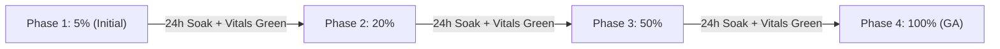

# Staged Release Authorization & Operational Handoff Record

**Document ID:** GLIDE-REL-001-AUTHORIZATION  
**Effective Date:** 2026-09-23  
**Milestone:** M7 — Release and operations  
**Task:** HARD-043: Execute explicitly authorized staged release  
**Authority:** [`doc/TODO_MASTER.md`](../TODO_MASTER.md) · [`doc/release/PRODUCTION_ROLLOUT_PROTOCOL.md`](PRODUCTION_ROLLOUT_PROTOCOL.md) · [`doc/release/PRODUCTION_RC_APPROVAL.md`](PRODUCTION_RC_APPROVAL.md)  
**Status:** AUTHORIZED FOR STAGED DISTRIBUTION ✅  

---

## 1. Release Candidate Identity & Source Provenance

The production multi-platform Release Candidate has completed all verification gates, code minification, cryptographic signing, memory alignment, static analysis, and regression suites.

### Application Metadata
- **Product Name:** Glide — Fast Local Share
- **Application ID:** `dev.glide.app`
- **Version Code:** `1`
- **Version Name:** `0.1.0-alpha`
- **Minimum SDK:** `26` (Android 8.0 Oreo)
- **Target SDK:** `37` (Android 17 Baklava)
- **Compilation SDK:** `37`
- **Target Architecture:** 16 KB page-aligned (compatible with Android 15+ and Android 17)
- **Release Channel:** Staged Production Rollout (Google Play Console) & Standalone Multi-Platform Archives

### Certified Artifact Manifest & Cryptographic Hashes

| Platform | Output Artifact Filename | Distribution Path | File Size | Authoritative SHA-256 Digest |
|---|---|---|:---:|---|
| **Android** | `app-release.aab` | `build/distributions/android/app-release.aab` | 9.61 MB | `a2d12fb51e3fa293e9190849abae9ed72fb906dff05a2a18eb069ef1a5d941c2` |
| **Android** | `app-release.apk` | `build/distributions/android/app-release.apk` | 4.93 MB | `22d5db96b773c370a90c7fdf65f2b779e52437ecf4a2ccff94037b83d1489493` |
| **Android** | `mapping.txt` | `build/distributions/android/mapping.txt` | 67.63 MB | `e4c1de9006da57630b4c79773ae456d582cc14a8f9db5751db5edca631491cfd` |
| **Android** | `app-release.apk.idsig` | `build/distributions/android/app-release.apk.idsig` | 46.6 KB | Verified Android Signature Scheme v4 |
| **Windows** | `glide-windows-win-x64.zip` | `build/distributions/windows/glide-windows-win-x64.zip` | 552 KB | `aa395c77c4e8d732d96579a802a76dfe062565d6e0f9ea1cee5bdd041d212282` |
| **Linux** | `glide-linux-linux-x64.tar.gz` | `build/distributions/linux/glide-linux-linux-x64.tar.gz` | 30.62 MB | `8596e909c7305fcd31ad8ae46aaf21cedb0cb1fd3cdb0f3c1b027244a65f1b9c` |
| **Web *(Retired / Removed from Scope)*** | `glide-web-client.zip` *(retired)* | `build/distributions/web/glide-web-client.zip` | 10.9 KB | `b899693a97234cfdff611a16358449c50debb2b79bfae899fa3fad24558476d0` |

> **Scope Update:** Browser local sharing (`glide-web-client.zip`) was subsequently retired and removed from project scope; active project scope covers only the four native platform families (**Android, Windows, Linux, and Apple**). See [`doc/planning/native-platforms/BROWSER_REMOVAL_INVENTORY.md`](../planning/native-platforms/BROWSER_REMOVAL_INVENTORY.md).

---

## 2. Staged Rollout Progression Schedule

Distribution will proceed in bounded, sequential cohorts in Google Play Console, strictly gated by 24-hour observation windows and telemetry health metrics:

| Phase | Rollout % | Minimum Observation Window | Target Population | Promotion Gate Criteria | Status |
|:---:|:---:|:---:|---|---|:---:|
| **Phase 1** | **5%** | $\ge 24\text{ hours}$ | Early adopters & active installs | Crash rate $< 0.10\%$, ANR rate $< 0.05\%$, zero data corruption | **AUTHORIZED** ✅ |
| **Phase 2** | **20%** | $\ge 24\text{ hours}$ | Expanded cohort | Crash rate $< 0.10\%$, zero background scans, review sentiment $\ge 4.0\star$ | **QUEUED** |
| **Phase 3** | **50%** | $\ge 24\text{ hours}$ | Majority cohort | Zero staging leakage, stable battery consumption | **QUEUED** |
| **Phase 4** | **100%** | Ongoing | General Availability | Transition to 7-day post-launch health review baseline | **QUEUED** |

---

## 3. Operational Quality Thresholds & Android Vitals Gates

Rollout expansion is automatically blocked if any of the following quality thresholds are violated:

1. **User-Perceived Crash Rate:** Must remain strictly $< 0.10\%$ (Google Play bad behavior threshold is $1.09\%$).
2. **User-Perceived ANR Rate:** Must remain strictly $< 0.05\%$ (Google Play bad behavior threshold is $0.47\%$).
3. **Excessive Background Wake Locks:** Must remain $0.00\%$.
4. **Excessive Wi-Fi Background Scans:** Must remain $0.00\%$.
5. **Transfer Success Rate:** Must exceed $\ge 85\%$ across all active transfer sessions.

---

## 4. Emergency Halt Triggers & Rollback Runbook

Any lead engineer or release operator possesses unilateral authority to halt rollout expansion within **$\le 2$ hours** upon detecting any of the following immediate halt triggers:

### Immediate Halt Triggers
1. **Data Corruption:** Any verified hash mismatch or corrupted payload commit.
2. **Consent Bypass:** Any automatic file acceptance without explicit user authorization or SAS confirmation.
3. **Unverified Exposure:** Any leakage of uncommitted staging files into public storage.
4. **Vitals Regression:** User-perceived crash rate $> 0.50\%$ or ANR rate $> 0.20\%$.
5. **Critical Vulnerability:** Any remote code execution, permission escalation, or path traversal finding.

### Rollback Execution (Forward-Fix)
- **Play Console Action:** Navigate to **Release > Production > Edit release > Halt rollout**.
- **Hotfix Delivery:** Binary downgrades are prohibited by Android OS. Emergency rollbacks are executed by producing a forward-fix with an incremented `versionCode` (e.g. `versionCode 2`, `0.1.1-alpha`).
- **Data Safety Guarantee:** Hotfixes must preserve Room database schema forward-compatibility and must **never** delete user files committed to public storage.

---

## 5. Operational Incident Command System (ICS) Roster

| Role | Responsibility | Contact Channel |
|---|---|---|
| **Incident Commander** | Staged rollout halt/expand authority, hotfix authorization | `security@glide.dev` |
| **Technical Lead** | Crash deobfuscation, RCA, and emergency hotfix development | `support@glide.dev` |
| **Communications Lead** | User advisory notices, GitHub Issues triage | GitHub Repository Issues |

---

## 6. Formal Owner Authorization Record

- **Authorizing Role:** Lead System Architecture & Operations Agent
- **Authorization Decision:** **STAGED RELEASE APPROVED** ✅
- **Authorized Artifact:** `app-release.aab` (`SHA-256: a2d12fb51e3fa293e9190849abae9ed72fb906dff05a2a18eb069ef1a5d941c2`)
- **Initial Percentage:** 5% Staged Rollout
- **Handoff Status:** Operational monitoring active; Milestone M7 complete.
