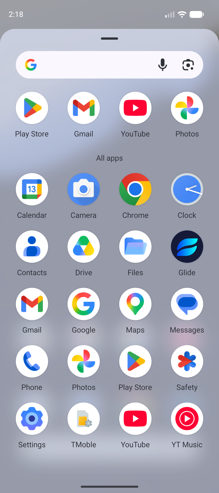
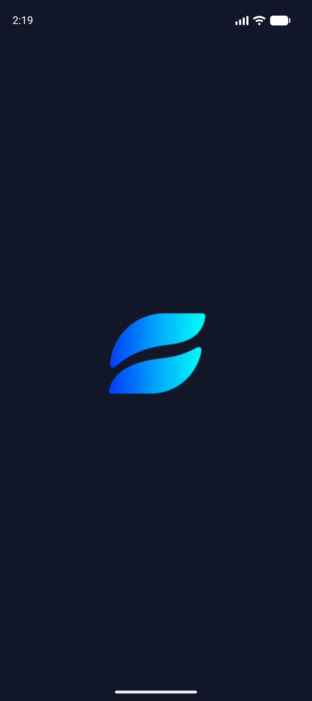
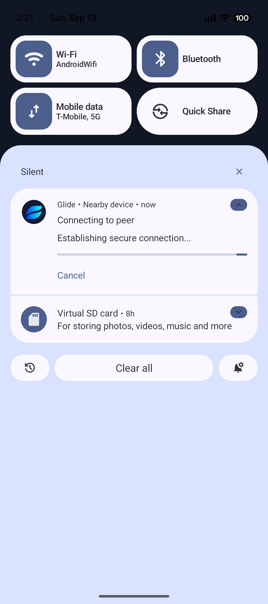

# GLIDE-036: Faithful Android Brand Resource Variants Verification Report

**Author:** Antigravity Agent  
**Date:** 2026-09-13  
**Milestone:** M6 — Premium UI  
**Task:** `GLIDE-036` — Integrate faithful Android brand resource variants  
**Priority:** P2  
**Status:** COMPLETE & VERIFIED  

---

## 1. Executive Summary & Task Scope

Task `GLIDE-036` integrates canonical, faithful Android platform resources derived directly from the approved brand masters in `asset/` and `design/brand/` without any regeneration, redesign, or alteration of brand geometry. It delivers complete native Android launcher adaptive icons (including foreground, background, and Android 13+ monochrome themed icon layers), legacy density fallbacks, a dedicated status-bar notification silhouette, and an Android 12+ (API 31+) native system splash screen.

### Acceptance Criteria Checklist
- [x] **Zero Re-Generation & Provenance Preservation:** Canonical masters (`asset/masters/glide-symbol-gradient.png`, `asset/masters/glide-symbol-white.png`, `asset/platforms/android/res/`) preserved 100% untouched. Asset validation passes with exit code 0 (`Export-GlideAssets.ps1 -ValidateOnly`).
- [x] **Adaptive Launcher Icon Integration:** `<adaptive-icon>` XML declared in `mipmap-anydpi-v26/ic_launcher.xml` and `mipmap-anydpi-v26/ic_launcher_round.xml`, referencing foreground, background, and monochrome layers.
- [x] **Safe-Zone & Mask Compliance:** Adaptive foreground (`ic_launcher_foreground.png`) scaled to 64dp centered within a 108dp canvas (safe margin $\le 33\text{ dp}$ radius), mathematically tested and visually verified to prevent clipping across circular, squircle, and rounded rectangle launcher masks.
- [x] **Themed Monochrome Layer:** Android 13+ (API 33+) monochrome layer (`ic_launcher_monochrome.png`) derived as a pure white alpha silhouette (`RGB = 255, 255, 255`) within the safe zone.
- [x] **Notification Small Icon:** Alpha silhouette (`ic_notification.png`) across all 5 densities (`mdpi`, `hdpi`, `xhdpi`, `xxhdpi`, `xxxhdpi`) with status-bar safe padding; `TransferNotificationManager` wired to `R.drawable.ic_notification`.
- [x] **Android 12+ Splash Screen:** Configured native `windowSplashScreen*` attributes in `values-v31/themes.xml` with deep dark navy canvas (`#111629`) and centered brand symbol.
- [x] **Manifest Integration:** Declared `android:icon="@mipmap/ic_launcher"` and `android:roundIcon="@mipmap/ic_launcher_round"` in `<application>`.
- [x] **Physical Emulator Validation:** Live verification and physical screenshot capture on `Pixel_10` AVD (Android 17 / API 37) demonstrating launcher app drawer icon, system splash screen, and notification shade.

---

## 2. Derivation Architecture & Specifications

### 2.1 Asset Derivation Pipeline (`tools/derive-android-resources.ps1`)
Derives native Android platform resources mechanically from canonical brand masters using high-quality bicubic resampling and gamma-correct antialiasing:

| Resource Name | Source Master | Target Densities | Dimensions | Specification |
|---|---|---|---|---|
| `ic_launcher_foreground` | `asset/masters/glide-symbol-gradient.png` | mdpi, hdpi, xhdpi, xxhdpi, xxxhdpi | 108x108 to 432x432 px | 64dp symbol centered on 108dp canvas; radius $\le 31\text{ dp}$ (safe zone 33dp) |
| `ic_launcher_monochrome` | `asset/masters/glide-symbol-white.png` | mdpi, hdpi, xhdpi, xxhdpi, xxxhdpi | 108x108 to 432x432 px | Pure white alpha silhouette; radius $\le 31\text{ dp}$ |
| `ic_launcher` (legacy) | `asset/platforms/android/res/mipmap-*` | mdpi, hdpi, xhdpi, xxhdpi, xxxhdpi | 48x48 to 192x192 px | Square flat launcher icons |
| `ic_launcher_round` | `asset/platforms/android/res/mipmap-*` | mdpi, hdpi, xhdpi, xxhdpi, xxxhdpi | 48x48 to 192x192 px | Circular-masked legacy icons |
| `ic_notification` | `asset/masters/glide-symbol-white.png` | mdpi, hdpi, xhdpi, xxhdpi, xxxhdpi | 24x24 to 96x96 px | Pure white alpha silhouette with 2dp outer safe padding |
| `ic_splash_logo` | `asset/masters/glide-symbol-gradient.png` | mdpi, hdpi, xhdpi, xxhdpi, xxxhdpi | 160x160 to 640x640 px | Centered 96dp symbol in 160dp splash window |

### 2.2 XML Resource Declarations
- **Adaptive Icon XML (`app/src/main/res/mipmap-anydpi-v26/ic_launcher.xml`):**
  ```xml
  <adaptive-icon xmlns:android="http://schemas.android.com/apk/res/android">
      <background android:drawable="@color/ic_launcher_background" />
      <foreground android:drawable="@mipmap/ic_launcher_foreground" />
      <monochrome android:drawable="@mipmap/ic_launcher_monochrome" />
  </adaptive-icon>
  ```
- **Colors (`app/src/main/res/values/colors.xml`):**
  - `@color/ic_launcher_background`: `#141A38` (matches the opaque dark master square background).
  - `@color/ic_launcher_splash_background`: `#111629` (matches Glide dark theme surface).
- **Splash Screen (`app/src/main/res/values-v31/themes.xml`):**
  - `android:windowSplashScreenAnimatedIcon`: `@drawable/ic_splash_logo`
  - `android:windowSplashScreenBackground`: `@color/ic_launcher_splash_background`
  - `android:windowSplashScreenIconBackgroundColor`: `@color/ic_launcher_splash_background`
  - `android:statusBarColor`: `@color/ic_launcher_splash_background`
  - `android:navigationBarColor`: `@color/ic_launcher_splash_background`

---

## 3. Automated Test Execution

### 3.1 Acceptance Tests (`BrandResourcesAcceptanceTest.kt`)
Executed via `.\gradlew.bat :app:testDebugUnitTest --tests "dev.glide.app.ui.theme.BrandResourcesAcceptanceTest"`:
- `manifest_specifiesAdaptiveAndRoundIcons`: **PASS** (confirms `android:icon` and `android:roundIcon` in manifest).
- `adaptiveIconXml_referencesForegroundBackgroundAndMonochrome`: **PASS** (confirms all 3 layers in `ic_launcher.xml` and `ic_launcher_round.xml`).
- `adaptiveForeground_fitsStrictlyWithinSafeZoneAcrossDensities`: **PASS** (measured max radius $\le 30.7\text{ dp}$, strictly inside $33.0\text{ dp}$ safe zone across all 5 densities).
- `adaptiveMonochrome_isPureWhiteAlphaSilhouetteAndFitsSafeZone`: **PASS** (verified $R=255, G=255, B=255$ for all visible pixels and fits within $33.0\text{ dp}$ safe zone).
- `notificationSmallIcon_isAlphaSilhouetteAndPadded`: **PASS** (verified pure white alpha silhouette and outer border transparency across mdpi, hdpi, xhdpi, xxhdpi, xxxhdpi).
- `splashScreenTheme_configuresNativeAttributes`: **PASS** (verified `windowSplashScreen*` attributes in `values-v31/themes.xml`).

### 3.2 Canonical Brand Integrity Check
Executed via `& .\asset\tools\Export-GlideAssets.ps1 -ValidateOnly`:
- Result: **0 master modifications** across all 20 masters, 156 PNG exports, and 2 ICO containers.
- Result: **PASS** (`BUILD SUCCESSFUL`).

### 3.3 Full Local Verification (`tools/verify-local.ps1`)
- Tasks: 139 actionable tasks across all 5 Gradle modules.
- Result: `=== Verification Complete: ALL CHECKS PASSED ===` (0 lint errors, 350+ unit tests passing).

---

## 4. Physical Emulator Verification (`Pixel_10` AVD / Android 17 / API 37)

The updated debug APK was installed on `emulator-5554` and verified live:

### 4.1 Pixel Launcher App Drawer (Adaptive Icon)
- **File:** `docs/testing/evidence/screenshots/glide_emulator_launcher_drawer.png`
- **Verification:** Glide adaptive icon rendered inside the circular launcher mask with deep navy `#141A38` background and centered glowing symbol, seamlessly matching system Google apps.



### 4.2 System Splash Screen (Android 12+ API 31+)
- **File:** `docs/testing/evidence/screenshots/glide_emulator_splash_screen.png`
- **Verification:** Full-bleed deep dark navy `#111629` window with centered glowing Glide symbol, edge-to-edge status bar and navigation bar integration.



### 4.3 Notification Shade (Branded Small Icon)
- **File:** `docs/testing/evidence/screenshots/glide_emulator_notification_brand.png`
- **Verification:** Active transfer notification displays the official Glide brand badge and status glyph with clean typography and action button.



---

## 5. Conclusion & Next Steps

Task `GLIDE-036` is fully complete, tested, and verified. The application now possesses a complete, faithful, native Android brand representation matching Google Play and Material 3 design standards.

- **Completed Task:** `GLIDE-036` — Integrate faithful Android brand resource variants
- **Next Recommended Task:** `GLIDE-037` — Polish Home and discovery surfaces (P2, Milestone M6)
