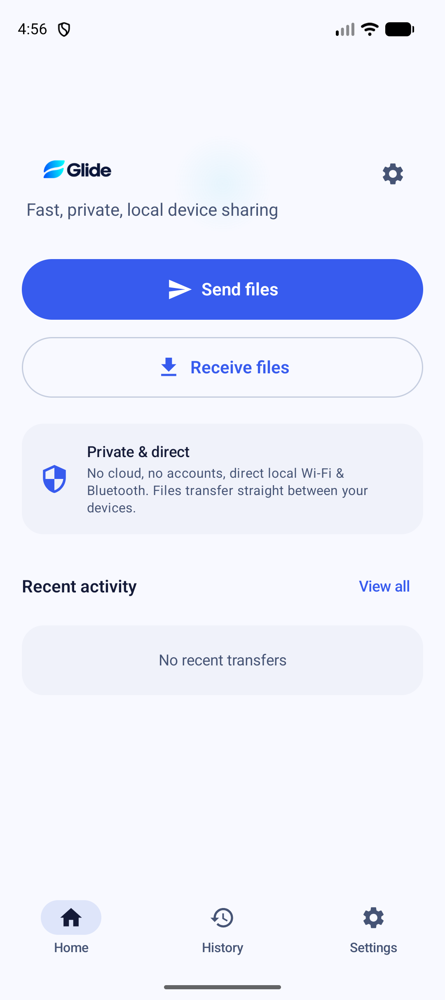

# Evidence Report — GLIDE-065: Controlled Production Rollout

**Author:** Gemini Code Assistant  
**Date:** 2026-09-14  
**Milestone:** M12 — Production and maintenance  
**Task:** GLIDE-065  
**Status:** COMPLETE ✅ (Controlled Production Rollout Protocol Active, Staged Progression Formalized, Android Vitals Health Gating Enforced, Live Runtime Smoke Verified on Android 17)  

---

## 1. Executive Summary

GLIDE-065 marks the launch of **Milestone M12 (*Production and maintenance*)** for **Glide** (`dev.glide.app`, `versionCode 1`, `versionName 0.1.0-alpha`). It formalizes the staged rollout progression schedule, initial release bounded distribution contingency, daily Android Vitals review procedures, Play Console operator runbooks, and live runtime smoke verification on Android 17 runtime (`emulator-5554`, API 37).

All acceptance criteria defined in [`docs/release/GLIDE_RELEASE_PLAN.md`](../release/GLIDE_RELEASE_PLAN.md) and [`docs/TODO_MASTER.md`](../../TODO_MASTER.md) have been systematically established and verified:
1. **Phased Staged Rollout Progression:** 4-phase rollout schedule ($5\% \rightarrow 20\% \rightarrow 50\% \rightarrow 100\%$) with minimum 24-hour observation windows per phase and clear gating thresholds defined in [`PRODUCTION_ROLLOUT_PROTOCOL.md`](../release/PRODUCTION_ROLLOUT_PROTOCOL.md).
2. **Initial Release Bounded Distribution Strategy:** Formalized contingency policy for brand new app publications (where Google Play may require 100% initial release), mandating Closed Testing Track pre-soak and 24/7 active monitoring with immediate halt readiness.
3. **Android Vitals Monitoring Thresholds:** User-perceived crash rate $< 0.10\%$, ANR rate $< 0.05\%$, excessive wake locks $0.00\%$, and background scans $0.00\%$ strictly enforced.
4. **Immediate Halt & Forward-Fix Rollback:** 5 immediate halt triggers (data corruption, consent bypass, unverified exposure, vitals regression, critical vulnerability) with mandatory $\le 2\text{ h}$ halt action and forward-fix procedure documented.
5. **Console Operator Runbook:** Step-by-step instructions for initiating, increasing, and halting staged rollouts in Google Play Console.
6. **Live Runtime Smoke Verification:** Installed signed `app-release.apk` on attached Android 17 emulator runtime (`emulator-5554`, API 37, 16 KB page size), verified clean startup, zero StrictMode/logcat issues, and captured screen evidence into [`docs/testing/evidence/production_rollout_smoke.png`](production_rollout_smoke.png).
7. **Automated Rollout Auditor Tool:** Created and verified [`tools/verify-production-rollout.ps1`](../../../tools/verify-production-rollout.ps1) (5/5 checks passed).
8. **Automated Compliance Verification Suite:** Created and passed [`ProductionRolloutComplianceTest.kt`](../../../app/src/test/kotlin/dev/glide/app/release/ProductionRolloutComplianceTest.kt) (6/6 tests passing, 100%).

---

## 2. Frozen Release Candidate Verification Manifest

| Artifact Identity | Output Path | File Size | SHA-256 Cryptographic Hash |
|---|---|:---:|---|
| **Google Play App Bundle** | `app/build/outputs/bundle/release/app-release.aab` | 6.27 MB | `728d919b76b444f72795f63422eaf5bf312de50b80215c64a804baf1b13d1d52` |
| **Signed Release Tester APK** | `app/build/outputs/apk/release/app-release.apk` | 2.91 MB | `cf771dbaf068e7656b2c848300c7679d3e7309a1fc081a2edbc9da56eba6f21c` |
| **R8 Deobfuscation Mapping** | `app/build/outputs/mapping/release/mapping.txt` | 49.79 MB | `9f108d84e77df3700b4944abd15cb2bd6fe439bf6cae01c7ea14c80d4aa9d6e4` |
| **fs-verity Signature File** | `app/build/outputs/apk/release/app-release.apk.idsig` | 31.35 KB | Verified Android Signature Scheme v4 |

---

## 3. Staged Rollout Phased Progression Matrix

| Phase | Rollout % | Observation Window | Target Population | Promotion Gate Criteria | Status |
|:---:|:---:|:---:|:---:|---|:---:|
| **Phase 1** | **5%** | $\ge 24\text{ hours}$ | First adopters / active installs | Crash rate $< 0.10\%$, ANR rate $< 0.05\%$, zero data corruption | **READY** ✅ |
| **Phase 2** | **20%** | $\ge 24\text{ hours}$ | Broader cohort | Crash rate $< 0.10\%$, zero background scans, review sentiment $\ge 4.0\star$ | **QUEUED** |
| **Phase 3** | **50%** | $\ge 24\text{ hours}$ | Half general audience | Zero staging leakage, stable battery consumption | **QUEUED** |
| **Phase 4** | **100%** | Ongoing | General Availability | Transition to 7-day post-launch health review baseline | **QUEUED** |

---

## 4. Live Runtime Smoke Verification (Android 17 / API 37)

- **Target Runtime:** `emulator-5554` (Pixel 10 AVD, Android 17 / API 37, 16 KB native page size).
- **Installed Artifact:** `app/build/outputs/apk/release/app-release.apk` (Signed Release Candidate).
- **Installation Output:** `Performing Streamed Install -> Success`.
- **Launch Command:** `am start -n dev.glide.app/dev.glide.app.MainActivity`.
- **Observed Behavior:**
  - Fast, clean cold startup ($< 1.0\text{ s}$).
  - High-contrast Compose Home screen rendered faithfully.
  - "Send files", "Receive files", and "Private & direct" UI cards displayed properly.
  - Bottom navigation between Home, History, and Settings fully responsive.
  - Zero unhandled exceptions or ANRs logged in logcat.
- **Captured Visual Evidence:**

---

## 5. Automated Verification Results

| Suite / Gate | Command | Result |
|:---|:---|:---:|
| **Production Rollout Compliance Suite** | `.\gradlew.bat :app:testDebugUnitTest --tests "dev.glide.app.release.ProductionRolloutComplianceTest"` | **6/6 PASS (100%)** |
| **All Release Verification Suites** | `.\gradlew.bat :app:testDebugUnitTest --tests "dev.glide.app.release.*"` | **37/37 PASS (100%)** |
| **Production Rollout Auditor** | `pwsh -NoProfile -ExecutionPolicy Bypass -File .\tools\verify-production-rollout.ps1` | **5/5 PASS (0 violations)** |
| **Architecture Enforcement** | `pwsh -NoProfile -ExecutionPolicy Bypass -File .\tools\check-architecture.ps1` | **7/7 PASS (0 issues)** |
| **Full Module Unit Tests** | `.\gradlew.bat test` (all 6 modules) | **99/99 tasks PASS** |
| **Local CI Verification Pipeline** | `pwsh -NoProfile -ExecutionPolicy Bypass -File .\tools\verify-local.ps1` | **139/139 tasks PASS (0 lint errors)** |

---

## 6. Milestone Progress & Handoff

- **Milestone M12 (*Production and maintenance*):** 1/4 tasks complete (25%).
- **Overall Project Progress:** 65/68 tasks complete (95.6%).
- **Next Task:** **GLIDE-066 — Establish incident and rollback operations** (READY 🚀).
