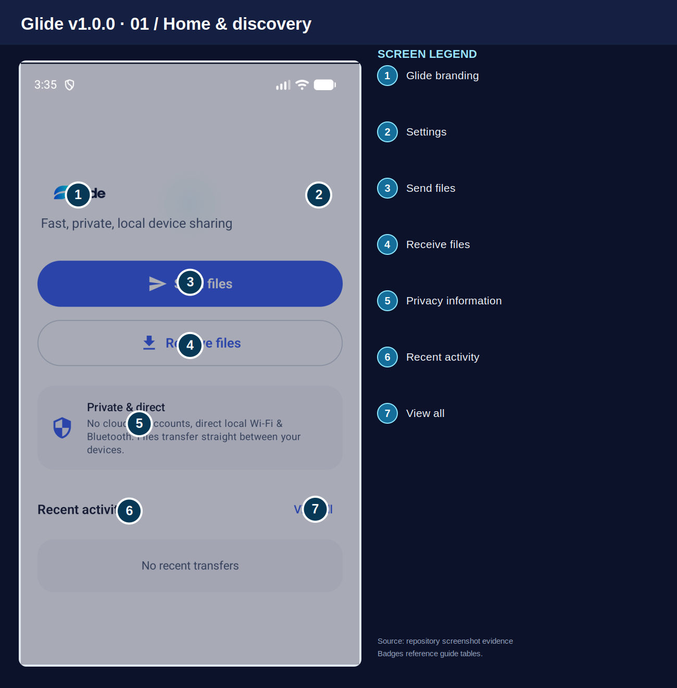
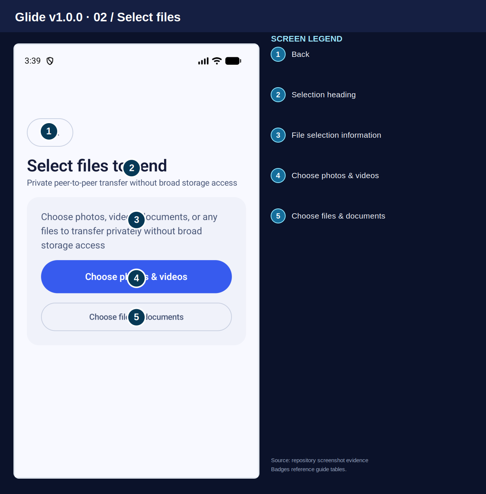
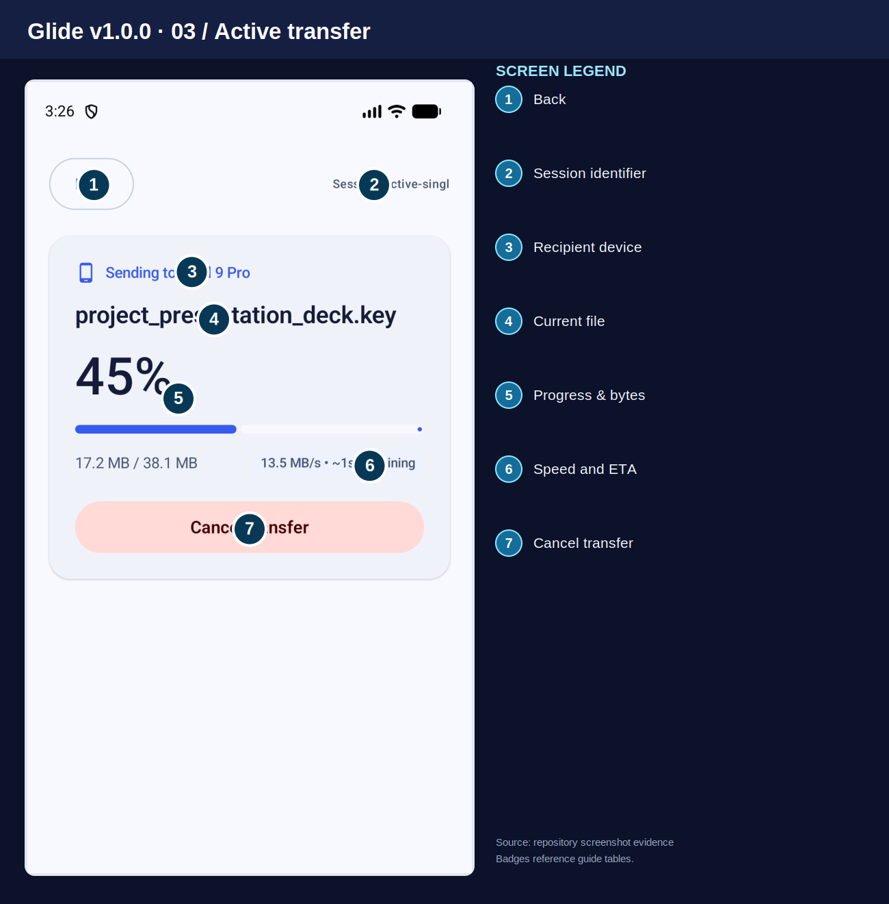
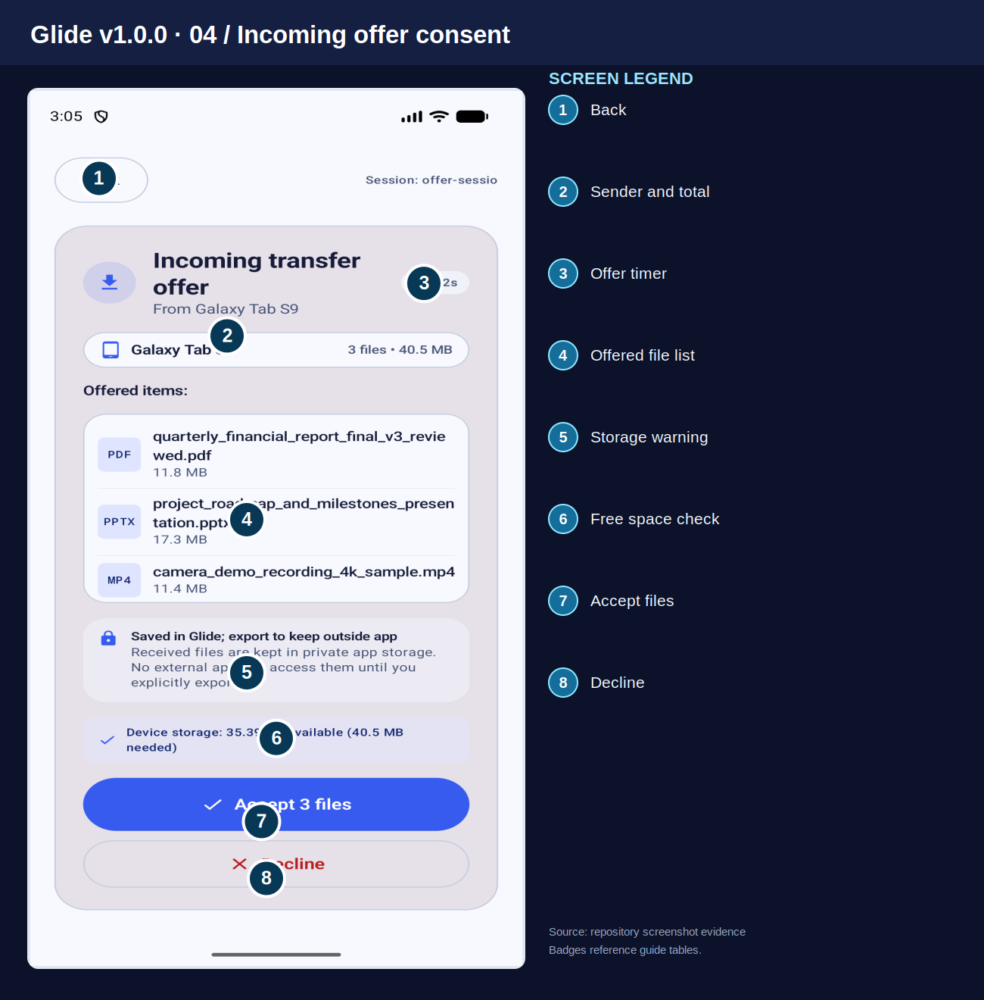
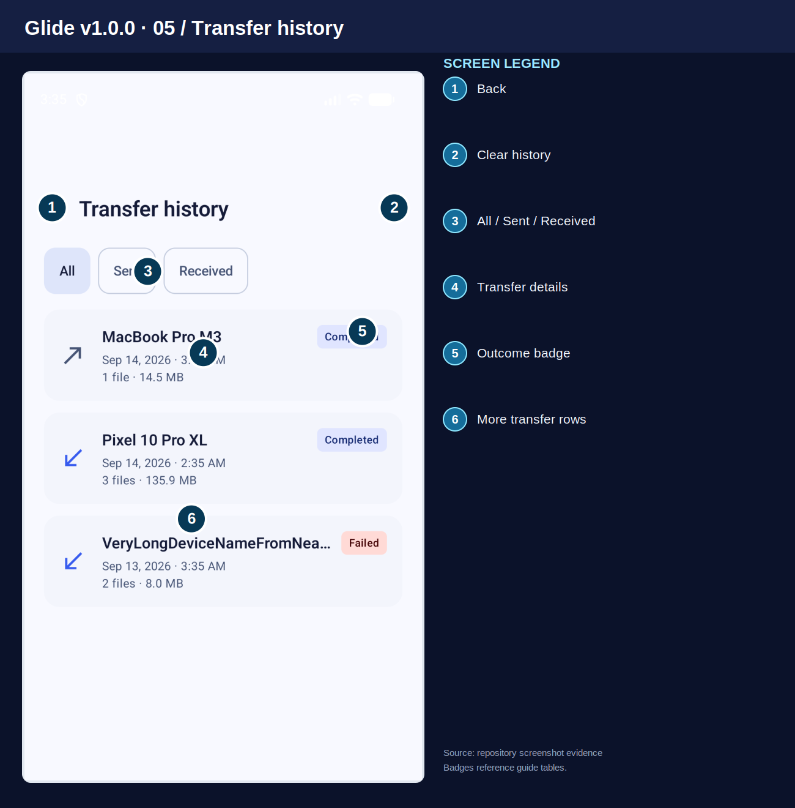
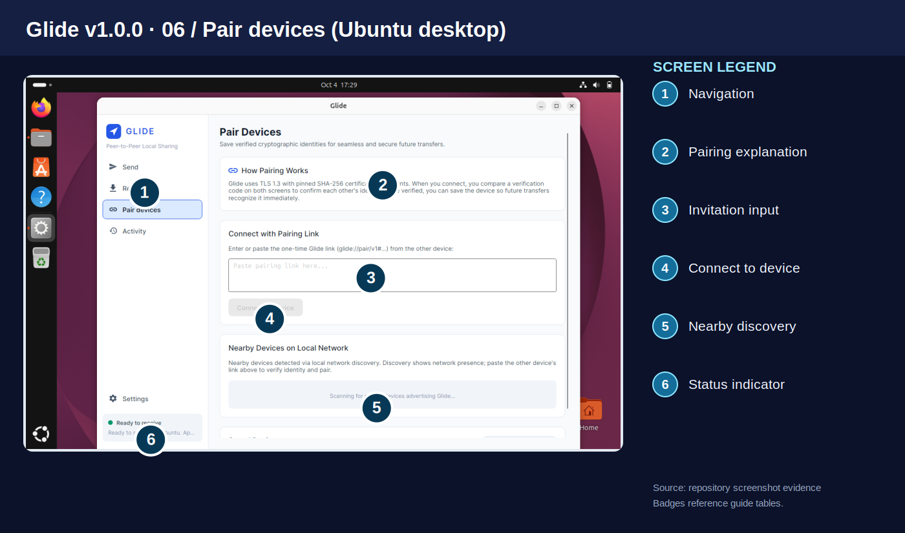
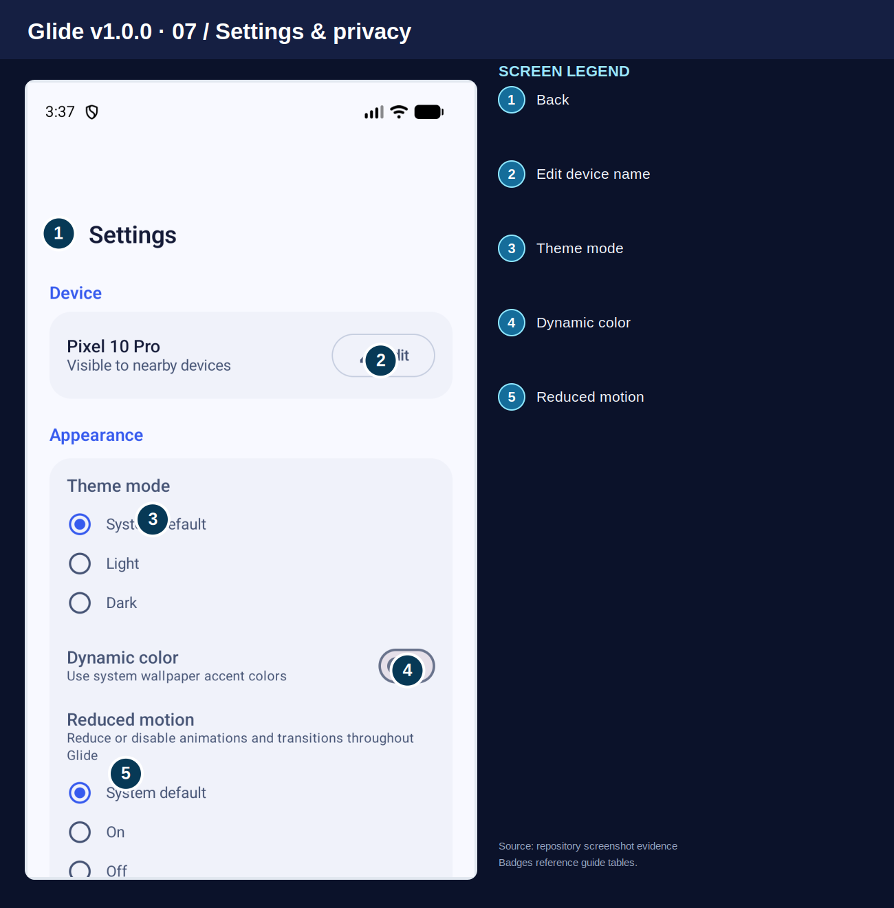

# Glide v1.0.0 — End-to-End Visual User Guide (English)

**Audience:** Android users, with notes for Windows and Ubuntu Linux desktop companions.  
**Application ID:** `dev.glide.app`  
**Screenshot provenance:** Existing Glide repository screenshots (Android phone release/store assets and Ubuntu desktop UI evidence). These are real saved screenshots, **not a fresh live capture of every v1.0.0 build state**. Screenshot layouts can differ by version, device, OS, theme, and screen size.  
**Review status:** Documentation candidate; final release qualification requires checking every image against the exact signed distribution.

## Safety before transferring
Glide transfers files between devices. Verify the **6-digit SAS Code** shown on both devices where prompted, and approve only the person/device you expect. A device name is **not proof of identity**. Never share a one-time pairing invitation publicly. A previously trusted device still may require consent for each incoming file offer.

## Contents
1. Home & discovery
2. File selection
3. Active transfer
4. Incoming offer and consent
5. Activity / history
6. Pair devices
7. Settings & privacy
8. First-time setup
9. Sending and receiving
10. Storage and troubleshooting
11. Desktop companion notes
12. Screenshot coverage / release verification

## 1. Home & discovery

| # | UI label / area | What it does |
|---:|---|---|
| 1 | `Glide branding` | Shows the application name and identity. |
| 2 | `Settings` | Opens device, appearance, storage, and privacy preferences. |
| 3 | `Send files` | Starts the file-selection and sending flow. |
| 4 | `Receive files` | Makes your device ready to receive a transfer from another device. |
| 5 | `Privacy information` | Explains Glide's direct local-sharing approach. |
| 6 | `Recent activity` | Shows the latest transfer record or an empty-state message. |
| 7 | `View all` | Opens the full transfer history. |

The numbered badges identify the controls visible in this example screenshot.

## 2. File selection

| # | UI label / area | What it does |
|---:|---|---|
| 1 | `Back` | Returns to the previous screen without starting a transfer. |
| 2 | `Selection heading` | Identifies the current file-selection step. |
| 3 | `File selection information` | Explains that Android's system picker limits broad storage access. |
| 4 | `Choose photos & videos` | Opens Android's photo/video picker. |
| 5 | `Choose files & documents` | Opens the system file picker for documents and other files. |

**Selection behavior:** Later screens allow batch review, removal, and **Proceed to send**. The screenshot is the initial choice state; it does **not** show an Apps tab or a dedicated file-category tab strip.

## 3. Active transfer

| # | UI label / area | What it does |
|---:|---|---|
| 1 | `Back` | Returns to the previous page; do not assume this cancels the transfer. |
| 2 | `Session identifier` | Shows the transfer session reference used for diagnosis. |
| 3 | `Recipient device` | Shows the device currently receiving your data. |
| 4 | `Current file` | Displays the file presently being transferred. |
| 5 | `Progress & bytes` | Shows percentage progress and transferred/total bytes. |
| 6 | `Speed and ETA` | Shows the current transfer speed and estimated remaining time, when available. |
| 7 | `Cancel transfer` | Stops the in-progress transfer; verified completed items may remain. |

**Important:** This screenshot shows **Cancel transfer**, not a Pause button. Speed/ETA are estimates.

## 4. Incoming offer and consent

| # | UI label / area | What it does |
|---:|---|---|
| 1 | `Back` | Navigates away; it is not a substitute for an explicit decline. |
| 2 | `Sender and total` | Shows the sending device and the proposed number/size of files. |
| 3 | `Offer timer` | Shows the remaining time to respond to this transfer request. |
| 4 | `Offered file list` | Lists proposed file names, types, and sizes; inspect before accepting. |
| 5 | `Storage warning` | Explains storage and export behavior for received files. |
| 6 | `Free space check` | Reports whether enough device storage is available. |
| 7 | `Accept files` | Approves this specific incoming file offer after identity verification. |
| 8 | `Decline` | Rejects this offer; no unwanted files should be accepted. |

**Important:** Identity/SAS verification happens at a different pairing stage; the incoming-offer screenshot itself does not display a SAS code.

## 5. Activity / history

| # | UI label / area | What it does |
|---:|---|---|
| 1 | `Back` | Returns to the previous screen. |
| 2 | `Clear history` | Opens the action to remove transfer records; this is not the same as deleting received files. |
| 3 | `All / Sent / Received` | Filters history by all, outgoing, or incoming transfers. |
| 4 | `Transfer details` | Opens a record to inspect its device, file information, and outcome. |
| 5 | `Outcome badge` | Shows Completed, Failed, or another recorded state. |
| 6 | `More transfer rows` | Lists other previous transfers; direction icons distinguish sent from received. |

The numbered badges identify the controls visible in this example screenshot.

## 6. Pair devices (Ubuntu desktop)

| # | UI label / area | What it does |
|---:|---|---|
| 1 | `Navigation` | Desktop pages for Send, Receive, Pair devices, Activity, and Settings. |
| 2 | `Pairing explanation` | Explains how verified pairing and trust work. |
| 3 | `Invitation input` | Paste a one-time glide://pair/v1 invitation from the other device. |
| 4 | `Connect to device` | Starts the connection after a valid invitation is provided. |
| 5 | `Nearby discovery` | Lists devices advertising Glide on the same accessible local network. |
| 6 | `Status indicator` | Reports readiness and pairing/receiving status. |

**Platform note:** This screenshot is from **Ubuntu desktop**, not Android. There is no separate universal LAN PIN field visible here; use the invitation link and code comparison presented by the actual pairing flow.

## 7. Settings & privacy

| # | UI label / area | What it does |
|---:|---|---|
| 1 | `Back` | Returns from Settings to the previous page. |
| 2 | `Edit device name` | Changes the name other nearby devices see. |
| 3 | `Theme mode` | Choose System default, Light, or Dark. |
| 4 | `Dynamic color` | Uses wallpaper-derived accent colors on supported Android versions. |
| 5 | `Reduced motion` | Controls reduced animations with System default, On, and Off. |

**More settings below the fold:** The screenshot is a partial scroll position. Depending on build, further sections include received-file location, notification details, keep-screen-awake, private received-file cleanup, diagnostics, privacy policy, and open-source licenses. No universal Wi-Fi Direct or auto-accept trusted toggle is shown.

## 8. First-time setup
1. Install Glide from an authorized channel. Confirm the app shows the expected publisher and `dev.glide.app` package on Android.
2. Open **Glide**. Open **Settings** and set a recognizable **Device name**.
3. Enable Bluetooth / Wi-Fi as prompted and approve the Android permissions needed for nearby discovery. Grant camera permission only when you use the QR scanner. Android system pickers grant access to the files you select, not your entire library.
4. Keep both devices within reliable network range. For LAN sharing, ensure both can reach the same local network; guest Wi-Fi or AP isolation can prevent discovery.
5. On the receiving device, choose **Receive files**. On the sending device, choose **Send files**.

## 9. Sending and receiving

### 9.1 Send files from Android
1. Tap **Send files**.
2. Choose **Choose photos & videos** or **Choose files & documents**; choose a folder where the installed build offers that option.
3. Review the selected batch, remove mistaken items, then tap **Proceed to send**.
4. Pick the recipient with **Nearby** discovery or use the QR/LAN invitation pairing flow offered by your installed version.
5. Compare the **6-digit SAS Code** on both devices and confirm only when it matches.
6. The recipient reviews the offered files and presses **Accept**; wait for integrity verification and a truthful completion result.
7. If the transfer fails, open **Activity / Transfer history** and inspect the status before retrying.

### 9.2 Receive files on Android
1. On the receiving device, tap **Receive files** and keep the readiness screen visible as required.
2. On the sender, select the expected recipient and complete pairing.
3. Compare the **6-digit SAS Code** if shown; decline a mismatch.
4. In **Incoming transfer offer**, confirm the sender device, file list, sizes, and available storage.
5. Tap **Accept** to receive, or **Decline** to reject. **Stop receiving** disables incoming readiness.
6. Do not treat a 100% progress animation alone as proof of success; wait for completion and integrity verification.

### 9.3 Pair devices (QR / LAN invitation)
1. On the receiver, create/show a one-time Glide pairing invitation using the available Receive/Pair flow.
2. On Android, use the QR scanner or **Paste invitation**; on Ubuntu desktop, open **Pair devices** and paste the `glide://pair/v1#...` link.
3. Use **Verify & connect** / **Connect to device** as appropriate.
4. Compare the six-digit verification codes shown on both devices, not merely the displayed names.
5. If offered, explicitly choose **Trust device** to retain the verified peer for later transfers. Trust is not unrestricted file auto-accept.
6. Regenerate expired invitations and revoke a peer from trusted-device controls if the device is lost or no longer authorized.

### 9.4 Understand transfer outcomes
**Completed** means the transfer was recorded as complete. **Failed** means the workflow did not finish successfully. **Cancelled** means someone stopped it. An interrupted session can have already verified some files; check the recipient and Activity before resending to avoid duplicates. If a receipt is unconfirmed, the sender may not know whether the recipient committed the item.

## 10. Storage, privacy, and troubleshooting

### 10.1 Storage
- Android may retain a private copy of received content until you explicitly export it or select a configured save folder. See **Settings → Received file save location**, **Choose folder**, and **Use Download/Glide**, where available.
- **Clear history** removes historical records, not necessarily the saved files.
- **Delete all** in private storage is a different, destructive action. Check its confirmation carefully before proceeding.
- Files received inside private app storage may be lost on app uninstall unless exported.

### 10.2 Common issues
| Problem | What to try |
|---|---|
| Cannot discover device | Enable the required radios/permissions, move devices closer, and check local Wi-Fi, AP isolation or VPN restrictions. |
| QR scan unavailable | Grant camera permission for QR use, or choose **Paste invitation** and paste the one-time `glide://pair/v1` link. |
| Pairing code differs | **Cancel**. Restart pairing; never approve an unexpected SAS mismatch. |
| Invitation expired | Generate a fresh invitation from the receiving device. |
| Permission denied for files | Re-open Android's system picker and select the file/folder again. |
| Not enough storage | Free space or choose a suitable destination before approving the offer. |
| Transfer failed or disconnected | Review **Activity**, reconnect, and retry using the supported workflow. Never assume byte-level resume is available in every build. |
| Saved file not visible in Downloads | Check Glide's private storage and **Export** / **Received file save location** behavior. |
| Transfer seems stuck | Check the receiving device's active consent screen, radio/network state, and background execution restrictions. |

## 11. Desktop companion notes
Windows and Ubuntu desktop use a sidebar with **Send**, **Receive**, **Pair devices**, **Activity**, and **Settings** rather than the Android home-first layout. UI labels and exact controls vary by platform.

- **Send:** **Add files…**, **Add folder…**, remove an item, **Clear all**, then choose **Quick share with QR**, **Nearby device**, or **Saved device** when available.
- **Receive:** start the receiving/listening state; inspect the pairing invitation and explicitly approve incoming offers.
- **Pair devices:** paste a one-time pairing link and verify matching codes before saving trust.
- **Activity:** search or filter **All / Sent / Received**; **Open Downloads** opens the configured destination, and **Clear history** clears records.
- **Settings:** configure **Follow System / Light / Dark**, **Device Name**, **Download Directory** (via **Browse…**), and **Trusted Devices**.
- On desktop, an invitation or discovered device is not itself proof of peer identity. Always complete code verification.

**Additional repository screenshots:** [Ubuntu Send](../../evidence/linux-ui/page-send-staged.png), [Ubuntu Receive](../../evidence/linux-ui/page-receive-listening.png), [Ubuntu Activity](../../evidence/linux-ui/page-activity.png), [Ubuntu Settings](../../evidence/linux-ui/page-settings.png), [Android QR scanner](../../android/ui-review-2026-09-27/after/scanner-paste.png).

## 12. Screenshot coverage / release verification
The seven numbered figures cover representative primary states: Android Home, initial Selection, Active Transfer, Incoming Offer, History, Ubuntu Pair devices, and Android Settings. They **do not** constitute a pixel-by-pixel capture of every dialog and setting across all Android, Windows, and Linux builds.

Before marking the guide release-final, capture and check missing states: Android permission dialogs; batch-selected state; discovery found/empty/timeout; SAS pairing; QR camera and paste; receiving readiness; success/failure/interrupt; history detail and clear-history confirmation; settings lower scroll and delete-files confirmation; desktop Send/Receive/Activity/Settings on Windows and Linux; dark/light modes; 200% font/DPI; and localization readability. Replace outdated figure images when needed without changing badge numbering unexpectedly.

**Source authority:** Current installed product UI > current source > captured screenshots > historical plans. The guide does not promise an **Apps picker tab**, **Pause** button, separate **LAN PIN field**, **Wi-Fi Direct toggle**, or **Auto-accept trusted toggle** unless a specific release build visibly provides it.
