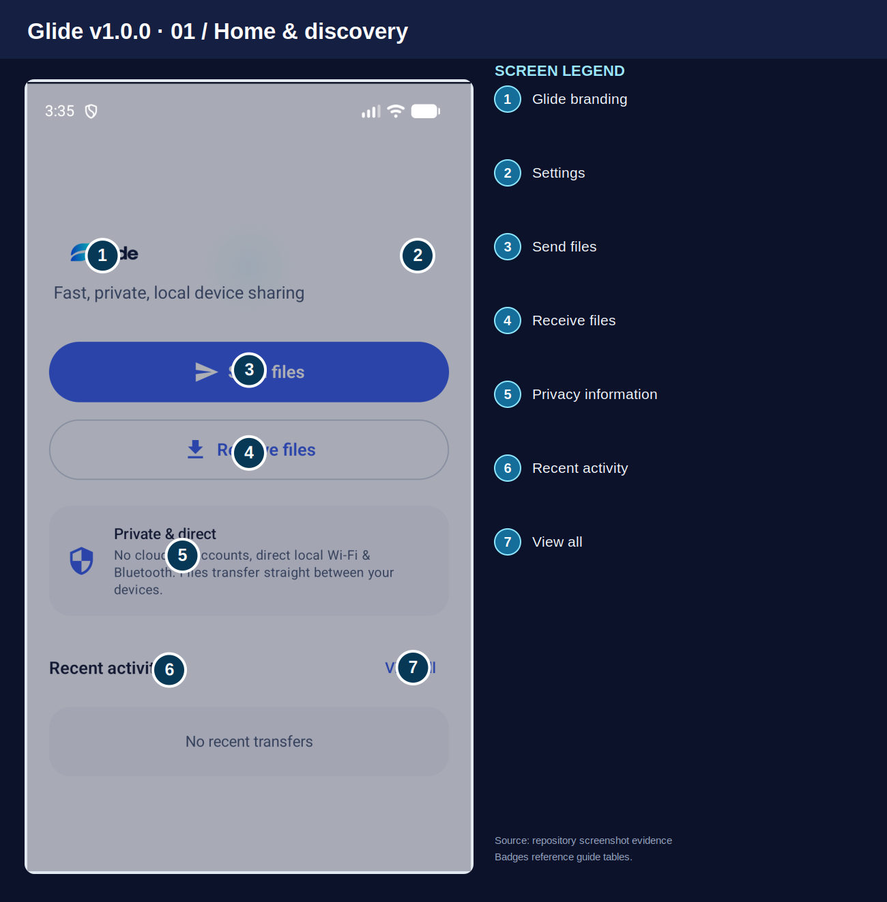
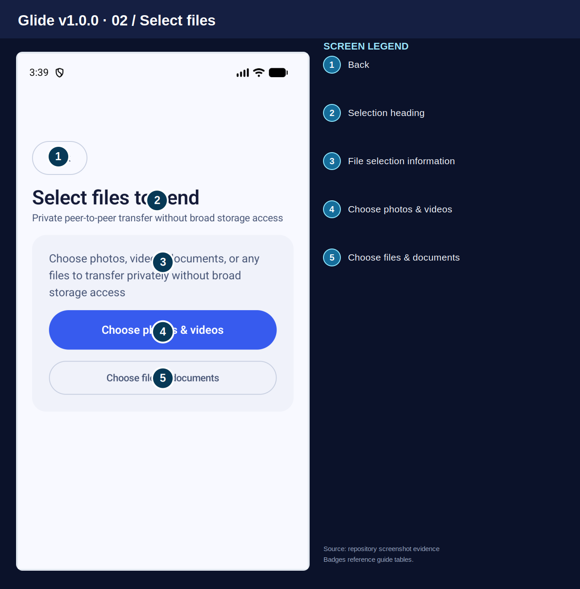
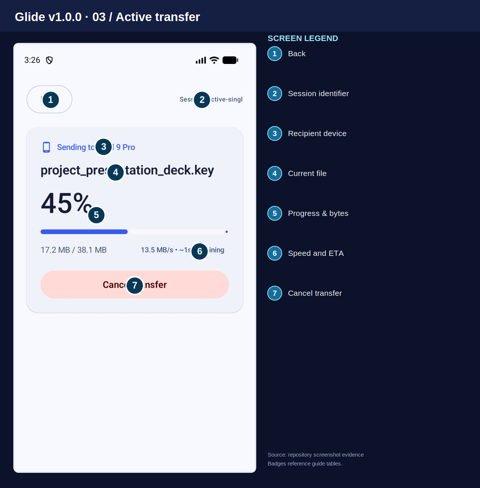
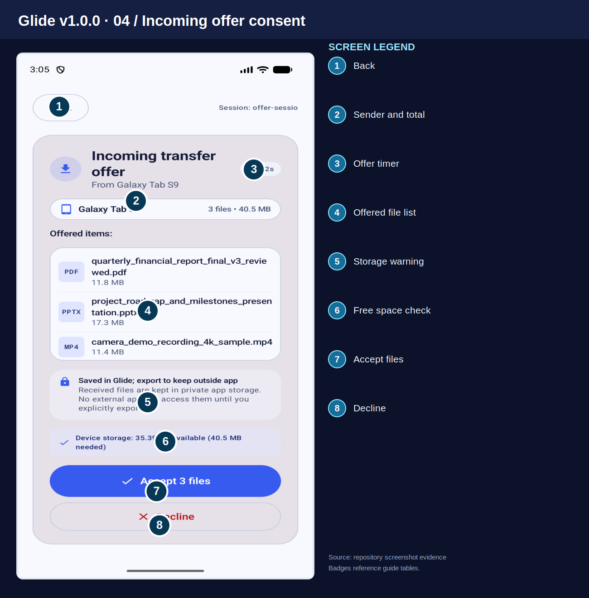
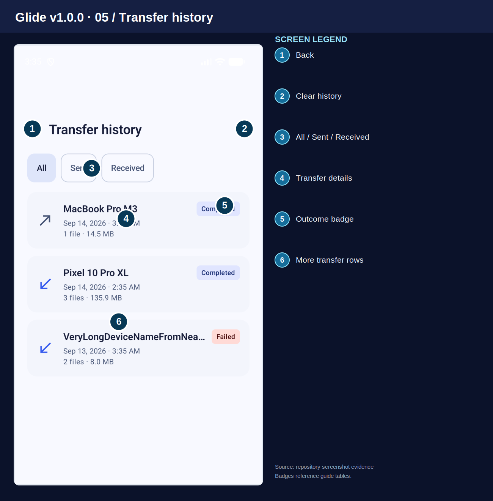
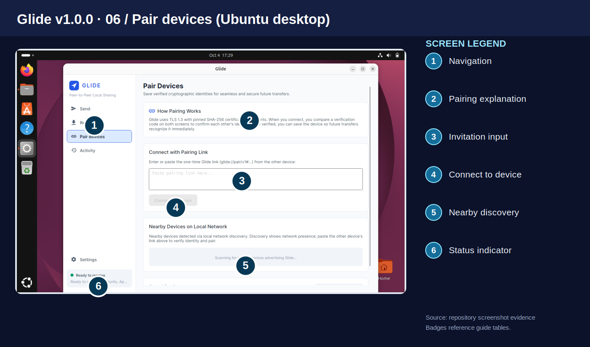
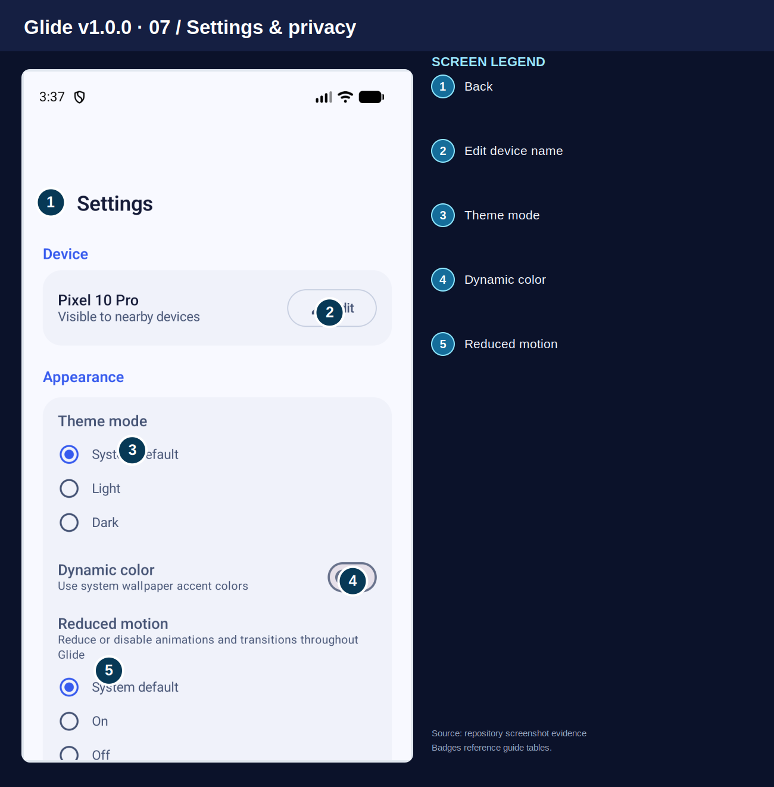

# Glide v1.0.0 — සම්පූර්ණ Visual User Guide (සිංහල + English)

**භාවිතා කරන්නන්:** Android users සඳහා ප්‍රධාන guide එකක්. Windows සහ Ubuntu Linux desktop versions සඳහා වෙනම උපදෙස් ද ඇතුළත් වේ.  
**Application ID:** `dev.glide.app`  
**Screenshots ගැන:** Glide repository එකේ තිබෙන සැබෑ Android සහ Ubuntu screenshots භාවිතා කර ඇත. ඒවා සියලුම v1.0.0 screens අලුතින් capture කළ බව නොවේ. Device, Version, Theme සහ Screen Size අනුව පෙනුම වෙනස් විය හැක.  
**Review status:** Release කිරීමට පෙර නිවැරදි signed app build එක මත screenshots නැවත verify කළ යුතුය.

## Files යැවීමට පෙර වැදගත් දේ
Glide භාවිතයෙන් devices අතර files transfer කරයි. `6-digit SAS Code` එක පෙන්වන අවස්ථාවේ දෙපසම codes ගැළපෙන බව පරීක්ෂා කරන්න. Device Name එක පමණක් හඳුනාගැනීමට ප්‍රමාණවත් නැහැ. `Pairing invitation` link එක වෙනත් අයට public ලෙස share නොකරන්න. කලින් `Trusted` කළ device එකකින් වුවත් එක් එක් `Incoming offer` එකට `Accept` කිරීමට අවශ්‍ය විය හැක.

## අන්තර්ගතය
1. Home & discovery
2. File selection
3. Active transfer
4. Incoming offer and consent
5. Activity / history
6. Pair devices
7. Settings & privacy
8. First-time setup
9. Sending and receiving
10. Storage and troubleshooting
11. Desktop companion notes
12. Screenshot coverage / release verification

## 1. Home & discovery

| # | UI label / area | කාර්යය |
|---:|---|---|
| 1 | `Glide branding` | යෙදුමේ නම සහ Glide හඳුනාගැනීම පෙන්වයි. |
| 2 | `Settings` | Device, Appearance, Storage සහ Privacy සැකසුම් වෙත යයි. |
| 3 | `Send files` | යැවීමට අවශ්‍ය files තෝරන Send ක්‍රියාවලිය ආරම්භ කරයි. |
| 4 | `Receive files` | වෙනත් device එකකින් files ලබාගැනීමට Receive ක්‍රියාවලිය සූදානම් කරයි. |
| 5 | `Privacy information` | Glide හි local device-to-device sharing ක්‍රමය පැහැදිලි කරයි. |
| 6 | `Recent activity` | අලුත්ම transfers පෙන්වයි; කිසිවක් නොමැති නම් ඒ බව පෙන්වයි. |
| 7 | `View all` | සියලු transfer records බලන්න Transfer history විවෘත කරයි. |

අංක සහිත badges මඟින් පෙන්වන්නේ මෙම screenshot එකේ ඇත්තටම පෙනෙන controls පමණි.

## 2. File selection

| # | UI label / area | කාර්යය |
|---:|---|---|
| 1 | `Back` | Transfer එකක් ආරම්භ නොකර පෙර screen එකට යයි. |
| 2 | `Selection heading` | දැන් ඔබ files තෝරන පියවරේ සිටින බව පෙන්වයි. |
| 3 | `File selection information` | Android system picker හරහා files තෝරන නිසා අනවශ්‍ය සම්පූර්ණ Storage access එකක් අවශ්‍ය නැති බව පැහැදිලි කරයි. |
| 4 | `Choose photos & videos` | Photos සහ Videos තෝරාගැනීමට Android picker එක විවෘත කරයි. |
| 5 | `Choose files & documents` | Documents ඇතුළු වෙනත් files තෝරාගැනීමට system file picker එක විවෘත කරයි. |

**සටහන:** පසුව `Proceed to send` සහ Batch review controls ලැබේ. මෙහි `Apps` Tab එකක් නොපෙනේ; ඒ නිසා එය guide එකේ ඇති බව නොකියයි.

## 3. Active transfer

| # | UI label / area | කාර්යය |
|---:|---|---|
| 1 | `Back` | පෙර page එකට යයි. මෙය Transfer එක Cancel කරන බව උපකල්පනය නොකරන්න. |
| 2 | `Session identifier` | ගැටලුවක් සොයාගැනීමට උපකාරී වන Session identifier පෙන්වයි. |
| 3 | `Recipient device` | Files යවන ලබන අනෙක් device එක පෙන්වයි. |
| 4 | `Current file` | දැනට transfer වන file එකේ නම පෙන්වයි. |
| 5 | `Progress & bytes` | Transfer progress percentage එක සහ යවා ඇති / මුළු data ප්‍රමාණය පෙන්වයි. |
| 6 | `Speed and ETA` | දැනට Speed එක සහ ඉතිරිව ඇති බවට අනුමාන කරන ETA කාලය පෙන්වයි. |
| 7 | `Cancel transfer` | දැනට ක්‍රියාත්මක Transfer එක නවත්වයි. සම්පූර්ණ කර Verify කළ files තවමත් තිබිය හැක. |

**වැදගත්:** මෙහි `Cancel transfer` තිබේ. `Pause` button එකක් මෙම screenshot එකේ නැහැ. `Speed` සහ `ETA` යනු අනුමාන අගයන්ය.

## 4. Incoming offer and consent

| # | UI label / area | කාර්යය |
|---:|---|---|
| 1 | `Back` | පෙර page එකට යයි; Decline කරන ක්‍රියාවට සමාන නොවේ. |
| 2 | `Sender and total` | Files එවන device එක, files ගණන සහ මුළු Size එක පෙන්වයි. |
| 3 | `Offer timer` | මෙම transfer request එකට ප්‍රතිචාර දීමට ඉතිරි කාලය පෙන්වයි. |
| 4 | `Offered file list` | එවීමට යෝජිත files වල නම්, types සහ sizes පෙන්වයි. Accept කිරීමට පෙර පරීක්ෂා කරන්න. |
| 5 | `Storage warning` | ලැබෙන files Save/Export වන ආකාරය හා Storage පිළිබඳ දැනුම්දීම පෙන්වයි. |
| 6 | `Free space check` | අවශ්‍ය files ලබාගැනීමට ප්‍රමාණවත් Device storage තිබේද කියා පෙන්වයි. |
| 7 | `Accept files` | Identity verification කළ පසු මෙම files ලබාගැනීම සඳහා Accept කරයි. |
| 8 | `Decline` | මෙම Offer එක ප්‍රතික්ෂේප කරයි; අනවශ්‍ය files ලබාගැනීම වළක්වයි. |

**වැදගත්:** `6-digit SAS Code` verification වෙනම Pairing step එකකි. මෙම `Incoming offer` screenshot එකේ SAS Code එක පෙන්වන්නේ නැහැ.

## 5. Activity / history

| # | UI label / area | කාර්යය |
|---:|---|---|
| 1 | `Back` | පෙර screen එකට යයි. |
| 2 | `Clear history` | Transfer records ඉවත් කිරීමේ ක්‍රියාව විවෘත කරයි. මෙය ලැබුණු files Delete කිරීම හා එකම දෙය නොවේ. |
| 3 | `All / Sent / Received` | සියලු transfers, යවා ඇති transfers හෝ ලැබුණු transfers පමණක් පෙන්වයි. |
| 4 | `Transfer details` | Device, File details සහ Result පරීක්ෂා කිරීමට record එක විවෘත කරයි. |
| 5 | `Outcome badge` | Transfer එක Completed, Failed හෝ වෙනත් status එකකදැයි පෙන්වයි. |
| 6 | `More transfer rows` | පෙර transfers පෙන්වයි; Arrow icons මඟින් Sent / Received හඳුනාගත හැක. |

අංක සහිත badges මඟින් පෙන්වන්නේ මෙම screenshot එකේ ඇත්තටම පෙනෙන controls පමණි.

## 6. Pair devices (Ubuntu desktop)

| # | UI label / area | කාර්යය |
|---:|---|---|
| 1 | `Navigation` | Desktop යෙදුමේ Send, Receive, Pair devices, Activity සහ Settings pages වෙත යාමට භාවිතා කරයි. |
| 2 | `Pairing explanation` | Pairing, code verification සහ Trust ක්‍රියා කරන ආකාරය පැහැදිලි කරයි. |
| 3 | `Invitation input` | අනෙක් device එකෙන් ලැබුණු one-time glide://pair/v1 invitation link එක Paste කරන්න. |
| 4 | `Connect to device` | වලංගු Invitation link එක ඇතුළත් කළ පසු Connect කිරීමට භාවිතා කරයි. |
| 5 | `Nearby discovery` | එකම local network එකේ Glide හරහා හඳුනාගත් devices පෙන්වයි. |
| 6 | `Status indicator` | Device එකේ Ready to receive ඇතුළු connection status පෙන්වයි. |

**Platform සටහන:** මෙය **Ubuntu desktop** screenshot එකකි. මෙහි වෙනම `LAN PIN` field එකක් නැහැ; `Pairing invitation` සහ UI එකේ පෙන්වන code comparison භාවිතා කරන්න.

## 7. Settings & privacy

| # | UI label / area | කාර්යය |
|---:|---|---|
| 1 | `Back` | Settings වලින් පෙර page එකට යයි. |
| 2 | `Edit device name` | අනෙක් devices වලට පෙනෙන Device Name එක වෙනස් කරයි. |
| 3 | `Theme mode` | System default, Light හෝ Dark Theme එක තෝරාගන්න. |
| 4 | `Dynamic color` | Support කරන Android versions වල wallpaper වර්ණවලට ගැලපෙන accent colors භාවිතා කරයි. |
| 5 | `Reduced motion` | Animations අඩු කිරීමට System default, On හෝ Off තෝරාගන්න. |

**පහළ Settings:** Scroll කළ විට `Received file save location`, `Notification details`, `Keep screen awake`, `Delete all`, `Nearby diagnostics`, `Privacy policy`, `Open source licenses` ආදී sections තිබිය හැක. `Wi-Fi Direct` හෝ `Auto-accept trusted` toggle එකක් මෙම screenshot එකෙන් තහවුරු නොවේ.

## 8. First-time setup
1. නිල හෝ විශ්වාසදායක source එකකින් **Glide** Install කරන්න. Android යෙදුමේ `dev.glide.app` Package එක සහ Publisher විස්තර පරීක්ෂා කරන්න.
2. **Glide** Open කර **Settings** තුළ ඔබට හඳුනාගත හැකි **Device name** එකක් ලබාදෙන්න.
3. ඉල්ලන විට **Bluetooth** / **Wi-Fi** සහ Nearby permissions Enable කරන්න. **QR scanner** භාවිතා කරන විට පමණක් **Camera permission** දෙන්න. Android system picker එකෙන් ඔබ තෝරාගත් files වලට පමණක් අවසර ලැබේ.
4. Devices දෙකම එකිනෙකට ලඟ තබන්න. **LAN** භාවිතා කරනවා නම් එකම සම්බන්ධ විය හැකි local network එකක ඇති බව තහවුරු කරන්න. **Guest Wi-Fi**, **VPN** හෝ **AP isolation** නිසා Discovery නතර විය හැක.
5. Files ලබාගන්නා device එකේ **Receive files** ද, යවන device එකේ **Send files** ද තෝරන්න.

## 9. Sending and receiving

### 9.1 Android එකෙන් files යවන්නේ කෙසේද?
1. **Send files** Tap කරන්න.
2. **Choose photos & videos** හෝ **Choose files & documents** තෝරන්න. ඔබගේ version එකේ **Choose folder** තිබේ නම් Folder එකක් ද තෝරාගත හැක.
3. තෝරාගත් files **Batch** එක නැවත බලන්න. වැරදි items ඉවත් කර **Proceed to send** Tap කරන්න.
4. **Nearby** හෝ **QR/LAN invitation** මඟින් ලබන device එක තෝරන්න.
5. දෙපසම පෙන්වන **6-digit SAS Code** සමානද බලන්න. වෙනස් නම් Connect නොකරන්න.
6. ලබන device එකේ **Incoming offer** බලලා **Accept** Tap කළ පසු Transfer complete සහ Verification result ලැබෙන තෙක් බලන්න.
7. **Failed** නම් **Activity / Transfer history** තුළ status බලලා නැවත Try කරන්න.

### 9.2 Android එකෙන් files ලබාගන්නේ කෙසේද?
1. File ලබාගන්නා device එකේ **Receive files** Tap කර Receive readiness On කරගන්න.
2. එවන device එකෙන් අදාළ recipient තෝරා **Pairing** අවසන් කරන්න.
3. පෙන්වන්නේ නම් **6-digit SAS Code** දෙක සසඳන්න. නොගැලපේ නම් **Cancel** / **Decline** කරන්න.
4. **Incoming transfer offer** තුළ Sender, Files, Sizes සහ Available Storage පරීක්ෂා කරන්න.
5. ලබාගැනීමට **Accept** කරන්න; අවශ්‍ය නොවේ නම් **Decline** කරන්න. **Stop receiving** මඟින් Receive readiness නවත්වන්න.
6. Progress 100% වීම පමණක් සාර්ථක transfer එකක් බවට සාක්ෂියක් නොවේ. **Completed** සහ Verification status බලන්න.

### 9.3 Pair devices — QR / LAN Invitation
1. Receiver එකේ ඇති **Receive / Pair** flow එකෙන් one-time **Pairing invitation** එකක් ලබාගන්න.
2. Android වලින් **Scan QR code** හෝ **Paste invitation** භාවිතා කරන්න. Ubuntu desktop වල **Pair devices** page එකේ `glide://pair/v1#...` link එක Paste කරන්න.
3. **Verify & connect** / **Connect to device** ඔබගේ screen එකට අනුව තෝරන්න.
4. දෙපසම පෙන්වන **6-digit SAS Code** සමාන බව සහතික කරන්න. Device Name එක පමණක් විශ්වාස නොකරන්න.
5. අවශ්‍ය නම් **Trust device** තෝරා Verified Peer එක save කරන්න. Trusted Device එකක් වුණත් සියලු files Auto Accept වන බවක් නොවේ.
6. Invitation එක Expire වුණොත් අලුත් Invitation එකක් ගන්න. Device එක නැතිවුණොත් **Trusted Devices** තුළින් Revocation කරන්න.

### 9.4 Transfer outcomes
**Completed** කියන්නේ transfer සාර්ථක ලෙස අවසන් වූ බවට record එකකි. **Failed** කියන්නේ අවසන් කිරීමට නොහැකි වූ බවයි. **Cancelled** කියන්නේ නතර කළ බවයි. සමහර files කලින්ම Verified වී තිබිය හැකි බැවින් නැවත යැවීමට පෙර ලබන device එක සහ **Activity** පරීක්ෂා කරන්න. Receipt තහවුරු නොවූ අවස්ථාවක Sender ට file එක Save වුණාද කියා නිශ්චිතව දැනගැනීමට නොහැකි විය හැක.

## 10. Storage, privacy, and troubleshooting

### 10.1 Storage
- Android යෙදුම ලැබුණු files **Private app storage** තුළ තබාගත හැක. **Settings → Received file save location**, **Choose folder**, **Use Download/Glide**, හෝ **Export** පවතින විට භාවිතා කරන්න.
- **Clear history** යනු Transfer records ඉවත් කිරීමයි; එයින් ලැබුණු files අනිවාර්යයෙන්ම Delete වන්නේ නැහැ.
- **Delete all** යනු වෙනම files Delete කිරීමේ ක්‍රියාවකි. Confirm කිරීමට පෙර පරීක්ෂා කරන්න.
- **Private app storage** තුළ පමණක් තිබෙන files App Uninstall කළ විට නැති විය හැක. වැදගත් files **Export** කර තබන්න.

### 10.2 Common issues
| ගැටලුව | කරන්න ඕනේ දේ |
|---|---|
| Device එක හමු නොවේ | අවශ්‍ය **Bluetooth/Wi-Fi permissions** Check කරන්න; devices ලඟ තබන්න; **VPN**, **Guest Wi-Fi**, **AP isolation** පරීක්ෂා කරන්න. |
| QR scan වැඩ නැහැ | **Camera permission** දෙන්න හෝ **Paste invitation** මඟින් `glide://pair/v1` link එක ඇතුළත් කරන්න. |
| SAS Codes වෙනස් | **Cancel** කරන්න. නැවත Pair කරන්න; ගැළපෙන්නේ නැති Code එක Confirm කරන්න එපා. |
| Invitation expired | Receiver එකෙන් අලුත් **Pairing invitation** එකක් ලබාගන්න. |
| Permission denied | Android **system file picker** එක නැවත විවෘත කර file/folder එක තෝරන්න. |
| Not enough storage | Storage ඉඩ නිදහස් කරන්න හෝ වෙනත් **Download Location** එකක් තෝරන්න. |
| Transfer failed | **Activity** බලලා Connect වී නැවත Try කරන්න. හැම build එකකම **True Resume** තිබෙනවා කියා නොසිතන්න. |
| Downloads තුළ file එක නොපෙනේ | **Private app storage**, **Export** සහ **Received file save location** පරීක්ෂා කරන්න. |
| Transfer එක නවතිලා වගේ | Receiver එකේ **Accept** දී ඇත්ද, Network සහ Background restrictions හරිද බලන්න. |

## 11. Desktop companion notes
Windows සහ Ubuntu desktop versions වල Android වගේ Home page එකක් වෙනුවට Side Navigation එකේ **Send**, **Receive**, **Pair devices**, **Activity**, **Settings** තිබේ. Platform අනුව controls වෙනස් විය හැක.

- **Send:** **Add files…**, **Add folder…**, item remove, **Clear all** භාවිතා කර **Quick share with QR**, **Nearby device**, හෝ **Saved device** තෝරන්න.
- **Receive:** Receive/listening mode On කර අදාළ **Pairing invitation** සහ **Incoming offer** Approve කරන්න.
- **Pair devices:** one-time link එක Paste කර **Verification code** compare කර Trust Save කරන්න.
- **Activity:** **All / Sent / Received** Filter/ Search කරන්න; **Open Downloads** මඟින් destination බලන්න; **Clear history** මඟින් records ඉවත් කරන්න.
- **Settings:** **Follow System / Light / Dark**, **Device Name**, **Download Directory**, **Browse…**, **Trusted Devices** සකසන්න.
- Desktop එකේත් හමු වූ Device Name එක පමණක් විශ්වාස නොකර **Code verification** සම්පූර්ණ කරන්න.

**තවත් screenshots:** [Ubuntu Send](../../evidence/linux-ui/page-send-staged.png), [Ubuntu Receive](../../evidence/linux-ui/page-receive-listening.png), [Ubuntu Activity](../../evidence/linux-ui/page-activity.png), [Ubuntu Settings](../../evidence/linux-ui/page-settings.png), [Android QR scanner](../../android/ui-review-2026-09-27/after/scanner-paste.png).

## 12. Screenshot coverage / release verification
අංක සහිත මෙම screenshots 7 මඟින් Android **Home**, **File Selection**, **Active Transfer**, **Incoming Offer**, **History**, Ubuntu **Pair devices**, සහ Android **Settings** පෙන්වයි. නමුත් මේවා Android, Windows, Linux සියලුම **Dialogs / Controls / States** වල නැවුම් screenshots නොවේ.

Final release එකට පෙර **Permissions**, **Selected batch**, **Device discovery**, **SAS verification**, **QR scanner**, **Receive readiness**, **Completed / Failed**, **History details**, **Settings පහළ කොටස්**, **Delete confirmation**, Windows / Linux සියලුම pages, Light/Dark Themes, සහ Large Text වැනි සියලු screens වෙන වෙනම Verify කරන්න.

**නිවැරදි තොරතුරු පරීක්ෂා කරන පිළිවෙළ:** Installed app → Current source → Screenshot evidence → Historical plans. යම් Release එකක නැති **Apps tab**, **Pause**, **LAN PIN input**, **Wi-Fi Direct toggle**, හෝ **Auto-accept trusted toggle** යන Controls තිබෙනවා යැයි මෙම Guide එකෙන් පොරොන්දු නොවේ.
